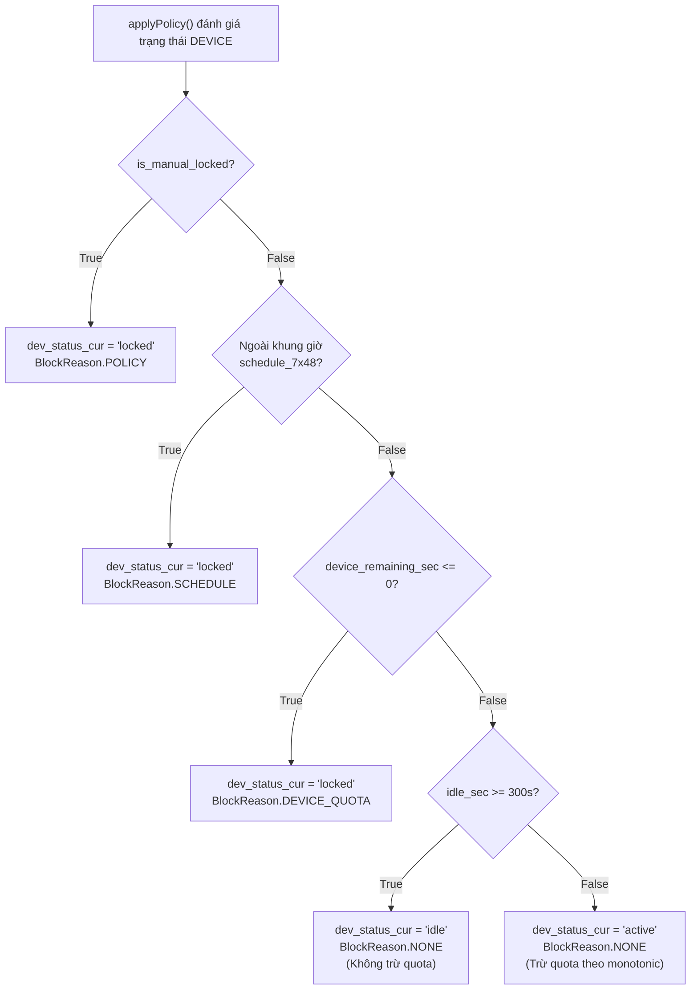
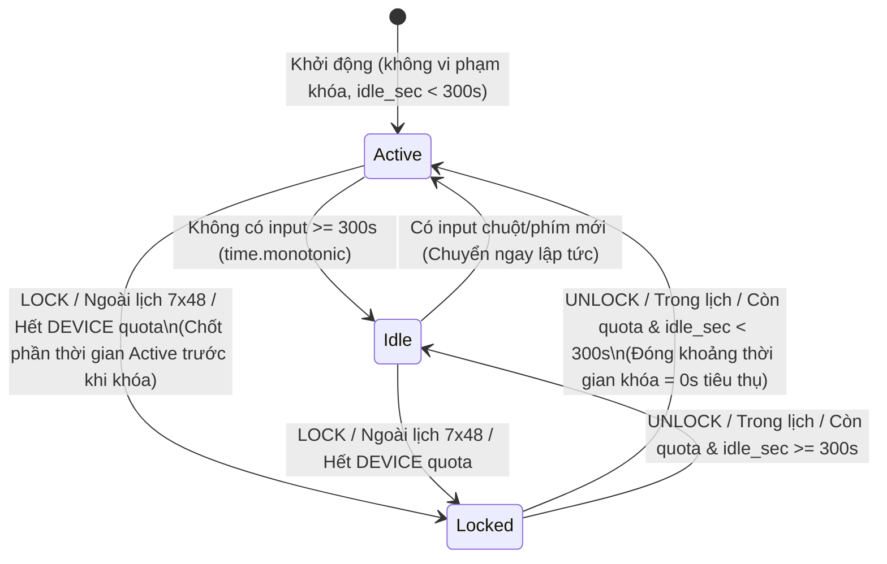

# OGK Engineering Learnings & Design Decisions

Tài liệu hiện tại: [luồng hoạt động](README.md), [hiện trạng](CURRENT_WORK.md), [cơ chế lệnh đã triển khai](design/QUOTA_SYNC.md). Phần dưới giữ lịch sử; kết quả triển khai và 143 test pass ngày 15/11/2026 nằm ở Mục 13 cuối file.

> **Tài liệu kỹ thuật nội bộ nhóm OGK**  
> **Mục đích:** Tổng hợp các vấn đề kỹ thuật thực tế phát sinh trong quá trình xây dựng và rà soát hệ thống OGK (Agent trên Windows & Server FastAPI), các quyết định thiết kế đã thống nhất, các bất biến trạng thái (`state invariants`) và các kỹ thuật lập trình hệ thống được áp dụng.  
> **Nguồn đối chiếu xác minh:** [`shared/schemas.py`](file:///c:/Users/Trieu/Computer_Networking/Project/shared/schemas.py), [`server/__init__.py`](file:///c:/Users/Trieu/Computer_Networking/Project/server/__init__.py), [`agent/__init__.py`](file:///c:/Users/Trieu/Computer_Networking/Project/agent/__init__.py), [`tests/test_schemas.py`](file:///c:/Users/Trieu/Computer_Networking/Project/tests/test_schemas.py) và [`REVIEW_SUMMARY.md`](file:///c:/Users/Trieu/Computer_Networking/Project/REVIEW_SUMMARY.md).

---

## 1. Introduction — OGK và mục tiêu kỹ thuật

**OGK** là hệ thống hỗ trợ quản lý thời gian và nội dung sử dụng máy tính của trẻ em trên Windows 10/11 theo nguyên tắc minh bạch, gồm hai thành phần cốt lõi giao tiếp qua mạng:

- **OGK-Agent** ([`agent/__init__.py`](file:///c:/Users/Trieu/Computer_Networking/Project/agent/__init__.py)): Chạy trên máy của trẻ, chịu trách nhiệm áp dụng chính sách (`Policy` — tập quy tắc giới hạn thời gian, lịch sử dụng và danh sách ứng dụng/website), đo thời gian sử dụng thực tế, kiểm tra thao tác người dùng (`Idle`/`Active`) và thực thi lệnh điều khiển từ phụ huynh.
- **OGK-Server** ([`server/__init__.py`](file:///c:/Users/Trieu/Computer_Networking/Project/server/__init__.py)): Dịch vụ trung tâm viết bằng FastAPI, quản lý đăng ký thiết bị (`Enrollment` — ghép đôi thiết bị lần đầu qua mã 8 ký tự), lưu trữ chính sách, tiếp nhận báo cáo định kỳ (`Heartbeat` — gói tin đồng bộ trạng thái mỗi 60 giây) và đẩy lệnh khẩn cấp qua `WebSocket` (kênh kết nối hai chiều duy trì liên tục theo thời gian thực).

Trong quá trình phát triển và thực hiện Code Review đa tác tử (`/review-all`), nhóm nhận thấy phần khó nhất của một hệ thống kiểm soát thời gian không nằm ở việc viết các API CRUD cơ bản, mà nằm ở **tính nhất quán trạng thái phân tán** giữa Server và Agent khi xảy ra các tình huống thực tế:

1. Hai kênh truyền thông bất đồng bộ (`Heartbeat` HTTP định kỳ và `WebSocket` thời gian thực) cùng tác động lên trạng thái khóa máy.
2. Nhiều nguyên nhân khóa máy cùng tồn tại (phụ huynh khóa thủ công, ngoài khung giờ lịch tuần, hết hạn mức thời gian thiết bị).
3. Hạn mức thời gian (`Quota` — ngân sách thời gian được phép sử dụng, tính bằng giây) vừa chịu tác động của cấu hình gốc trong `Policy`, vừa chịu điều chỉnh cộng/trừ (`ADD_TIME`/`SUB_TIME`) và thời gian đã tiêu thụ.
4. Quá trình khởi động lại (`Restart`/`Reboot`) của Agent hoặc Server, sự cố rớt mạng, hoặc hành vi chỉnh lùi đồng hồ hệ thống của người dùng có thể làm sai lệch bộ đếm thời gian nếu chỉ dựa vào đồng hồ hệ thống thông thường.

---

## 2. Engineering Problems — Các vấn đề thực tế

### A. Command handling và Lock state (Finding C-1)

#### 1. Hai kênh nhận lệnh nhưng trùng lặp logic thực thi
Hệ thống duy trì hai phương thức truyền lệnh với vai trò vận hành khác nhau:
- **Kênh `WebSocket` (`/ws/urgent`):** Truyền các lệnh khẩn cấp (`LOCK`, `UNLOCK`, `ADD_TIME`, `SUB_TIME`) đòi hỏi độ trễ thấp (dưới 5 giây) khi Agent đang trực tuyến.
- **Kênh `Heartbeat` (`/api/v1/heartbeat`):** Đóng vai trò kênh đồng bộ định kỳ (mỗi 60 giây) và kênh dự phòng (`fallback` — cơ chế chuyển đổi dự phòng khi kênh chính gặp sự cố) cho các lệnh `LOCK`/`UNLOCK` lưu trong `pending_commands` khi kết nối `WebSocket` bị đứt.

Ở phiên bản trước khi sửa C-1, logic xử lý lệnh `LOCK`/`UNLOCK` bị viết lặp lại ở hai nơi độc lập: một nhánh trong [`HeartbeatResponseHanlder()`](file:///c:/Users/Trieu/Computer_Networking/Project/agent/__init__.py#L475-L511) và một nhánh trong hàm xử lý lệnh khẩn. Việc nhân đôi logic nghiệp vụ (`duplicate implementation`) dẫn đến nguy cơ khi cập nhật quy tắc khóa máy ở một kênh thì kênh còn lại bị lệch hành vi.

#### 2. Nguy cơ `applyPolicy()` vô tình ghi đè trạng thái khóa thủ công của phụ huynh
Thiết bị có thể bị khóa bởi 3 nguyên nhân khác nhau (định nghĩa tại [`BlockReason`](file:///c:/Users/Trieu/Computer_Networking/Project/shared/schemas.py#L36-L43)):
- `BlockReason.POLICY`: Phụ huynh chủ động khóa máy thủ công (`manual lock`) qua lệnh `LOCK`.
- `BlockReason.SCHEDULE`: Thời điểm hiện tại nằm ngoài khung giờ cho phép trong ma trận lịch tuần `schedule_7x48` (7 ngày $\times$ 48 khung 30 phút).
- `BlockReason.DEVICE_QUOTA`: Thiết bị đã dùng hết ngân sách thời gian trong ngày (`automatic lock` do cạn quota).

**Lỗi thực tế đã gặp:** Trước khi có cờ trạng thái riêng cho khóa thủ công, lệnh `LOCK` chỉ gán `dev_status_cur = "locked"` và `device_block_reason = BlockReason.POLICY`. Ngay ở nhịp `Heartbeat` kế tiếp (hoặc khi phụ huynh cộng giờ cho một ứng dụng làm [`applyPolicy()`](file:///c:/Users/Trieu/Computer_Networking/Project/agent/__init__.py#L301-L438) chạy lại), hàm `applyPolicy()` kiểm tra thấy thiết bị vẫn nằm trong khung giờ `schedule_7x48` và chưa hết `DEVICE_QUOTA`, nên rơi vào nhánh `else` và **tự động mở khóa lại máy (`dev_status_cur = "active"`)**, vô hiệu hóa lệnh khóa của phụ huynh. Ngược lại, khi phụ huynh gửi lệnh `UNLOCK`, nếu code chỉ gán thẳng `dev_status_cur = "active"` mà không kiểm tra lại `applyPolicy()`, máy sẽ mở khóa cả khi đang trong giờ cấm của `SCHEDULE` hoặc đã cạn `DEVICE_QUOTA`.

---

### B. Quota accounting — Hạch toán thời gian cộng/trừ (Finding C-2)

#### 1. Vấn đề chặn dưới (`clamp` — giới hạn giá trị không vượt quá ngưỡng) sai vị trí đối với `SUB_TIME`
Đối với từng ứng dụng (`APP`) và tên miền (`WEB`), hạn mức thời gian có cấu trúc gồm 3 thành phần:
- `policy_quota`: Hạn mức gốc quy định trong [`AppRule`](file:///c:/Users/Trieu/Computer_Networking/Project/shared/schemas.py#L124-L128) hoặc [`DomainRule`](file:///c:/Users/Trieu/Computer_Networking/Project/shared/schemas.py#L131-L135).
- `total_adjustment`: Tổng lượng thời gian phụ huynh điều chỉnh qua các lệnh `ADD_TIME` (`+bonus_time`) và `SUB_TIME` (`-sub_time`), lưu trong `app_bonus_time` và `web_bonus_time`.
- `used_time`: Thời gian thực tế trẻ đã sử dụng trong chu kỳ, lưu trong `quota_used`.

**Lỗi thực tế đã gặp:** Ở phiên bản cũ, khi nhận lệnh `SUB_TIME`, cả Server và Agent đều tính `app_bonus_time[a_name] = max(0, app_bonus_time.get(a_name, 0) - cmd.sub_time)`. Việc chặn dưới biến điều chỉnh ở `0` khiến phụ huynh chỉ trừ được phần giờ thưởng thêm trước đó, chứ **không thể trừ lẹm vào hạn mức gốc (`policy_quota`)**. Ví dụ: `roblox.exe` có `policy_quota = 600s`, trẻ chưa được thưởng thêm phút nào (`adjustment = 0`) và đã dùng `100s`; khi phụ huynh gửi `SUB_TIME = 250s`, công thức cũ tính `max(0, 0 - 250) = 0`, làm thời gian còn lại vẫn giữ nguyên `500s` thay vì giảm xuống `250s`.

#### 2. Bảo toàn trạng thái khi `Policy` cập nhật phiên bản mới
Khi phụ huynh thay đổi cấu hình trên Dashboard (tăng hoặc giảm `policy_quota`), Agent tải `Policy` mới khi phát hiện `latest_policy_version > cur_policy_version`. Nếu hệ thống gán đè hoặc xóa `total_adjustment` và `used_time`, phần thời gian trẻ đã dùng hoặc phần giờ phụ huynh vừa thưởng/phạt trong ngày sẽ bị mất hoặc bị tính trùng.

---

### C. DEVICE quota lifecycle — Vòng đời hạn mức thiết bị (Finding C-3)

#### 1. Bẫy giá trị `0` của `device_unlocked_until`
Ban đầu, hạn mức toàn thiết bị được biểu diễn bằng mốc thời gian mở khóa `device_unlocked_until` (mặc định khởi tạo bằng `0`). Trong [`applyPolicy()`](file:///c:/Users/Trieu/Computer_Networking/Project/agent/__init__.py#L301-L438) từng tồn tại đoạn kiểm tra:
```python
if device_unlocked_until == 0 :
    device_unlocked_until = int(time.time()) + limit_sec
```
**Lỗi thực tế đã gặp:**
- Khi phụ huynh gửi lệnh `SUB_TIME` lớn làm `device_unlocked_until = max(0, device_unlocked_until - cmd.sub_time)` chạm mốc `0`, lệnh gọi `applyPolicy()` ngay sau đó hiểu nhầm `0` là "thiết bị mới khởi động lần đầu chưa được cấp quota", dẫn đến việc **tự động cấp mới lại toàn bộ hạn mức ngày (`limit_sec`)** thay vì khóa máy.
- Tương tự, khi Agent khởi động lại trong ngày (`device_unlocked_until` trong RAM về `0`) hoặc khi [`HeartbeatResponseHanlder()`](file:///c:/Users/Trieu/Computer_Networking/Project/agent/__init__.py#L475-L511) dùng điều kiện `if data.device_unlocked_until > 0:` (bỏ qua giá trị `0` từ Server trả về), thiết bị đã cạn hạn mức sẽ tự mở khóa lại hoặc không đồng bộ được trạng thái hết giờ từ Server.

#### 2. Sai lệch khi dùng Wall Clock để đo thời gian sử dụng và nguy cơ từ Reboot
- Nếu chỉ dùng đồng hồ hệ thống (`Wall clock` — thời gian thực tế theo lịch ngày/giờ của hệ điều hành, lấy qua `time.time()`) để so sánh hạn mức, khi người dùng chỉnh lùi đồng hồ hệ thống 3 giờ (`-10800` giây), khoảng cách đến mốc hết hạn sẽ tăng thêm 3 giờ.
- `time.monotonic()` đo số giây từ một mốc cố định không cần biết trước, không bị đổi khi chỉnh giờ máy. Chỉ lấy chênh lệch giữa hai lần đọc trong cùng phiên đo. Không lưu mốc này để dùng lại sau khi khởi động hệ điều hành; khi khôi phục dữ liệu, bỏ mốc cũ và giữ số giây đã sử dụng.

---

### D. Idle / Active và Usage Time — Đếm thời gian sử dụng thực tế (Yêu cầu F1)

Đặc tả chức năng **F1** quy định: *"Đếm thời gian sử dụng thực: không tính khi máy khóa hoặc không có thao tác quá 5 phút"*.

Nếu bộ đếm hạn mức chỉ trừ lùi theo thời gian trôi qua kể từ lúc bật máy:
- Khi trẻ rời khỏi bàn học quá 5 phút (máy không có thao tác bàn phím/chuột — trạng thái `Idle`), thời gian nghỉ vẫn bị trừ vào hạn mức ngày.
- Khi máy đang bị khóa (`Locked` do lệnh `LOCK` của phụ huynh hoặc ngoài khung giờ `SCHEDULE`), hạn mức ngày vẫn tiếp tục hao hụt.
- Khi chuyển tiếp qua lại giữa các trạng thái `Active` $\leftrightarrow$ `Idle` $\leftrightarrow$ `Locked`, nếu không chốt (`flush` — ghi nhận dứt điểm phần dữ liệu đang chờ tính toán) thời gian đã chạy của trạng thái trước khi đổi trạng thái, hệ thống sẽ làm mất số giây `Active` ngay trước thời điểm khóa hoặc tính trùng khoảng thời gian `Idle` vào lần thao tác kế tiếp.

---

## 3. Design Decisions — Các quyết định đã thống nhất

### 3.1. Phân tách kênh truyền lệnh nhưng hợp nhất hàm thực thi [`execCmd()`](file:///c:/Users/Trieu/Computer_Networking/Project/agent/__init__.py#L526-L588)
- **Quyết định:** Giữ nguyên hai kênh nhận lệnh (`Heartbeat` cho đồng bộ định kỳ/dự phòng khi mất kết nối và `WebSocket` cho lệnh khẩn cấp thời gian thực), nhưng mọi lệnh khi tới Agent đều phải đi qua một hàm thực thi duy nhất là [`execCmd(cmd: Cmd)`](file:///c:/Users/Trieu/Computer_Networking/Project/agent/__init__.py#L526-L588).
- **Bảo toàn nguyên nhân khóa (State Priority Invariant):**
  - Tách cờ độc lập `is_manual_locked: bool` ([`agent/__init__.py`](file:///c:/Users/Trieu/Computer_Networking/Project/agent/__init__.py#L126)) chỉ bật khi nhận `CommandType.LOCK` và chỉ tắt khi nhận `CommandType.UNLOCK`.
  - Trong [`applyPolicy()`](file:///c:/Users/Trieu/Computer_Networking/Project/agent/__init__.py#L427-L438), thứ tự ưu tiên đánh giá trạng thái thiết bị luôn cố định:
    1. `is_manual_locked == True` $\rightarrow$ `dev_status_cur = "locked"`, `device_block_reason = BlockReason.POLICY`.
    2. Ngoài khung giờ `schedule_7x48` $\rightarrow$ `dev_status_cur = "locked"`, `device_block_reason = BlockReason.SCHEDULE`.
    3. `device_remaining_sec <= 0` $\rightarrow$ `dev_status_cur = "locked"`, `device_block_reason = BlockReason.DEVICE_QUOTA`.
    4. Không vi phạm các điều kiện khóa trên $\rightarrow$ `device_block_reason = BlockReason.NONE`, xét `dev_status_cur = "idle"` (nếu không thao tác $\ge 300$ giây) hoặc `"active"`.



---

### 3.2. Công thức bất biến cho Quota Accounting (Signed Adjustment)
- **Quyết định:** Xem hạn mức là ngân sách cơ sở (`policy_quota`), các lệnh `ADD_TIME` và `SUB_TIME` cộng/trừ trực tiếp vào biến điều chỉnh có dấu (`total_adjustment` có thể dương hoặc âm). Không chặn dưới `total_adjustment` ở `0`; chỉ chặn dưới kết quả thời gian còn lại (`remain`) ở `0`:
  $$\text{remain} = \max(0,\ \text{policy\_quota} + \text{total\_adjustment} - \text{used\_time})$$
- **Khi cập nhật `Policy` mới:** Chỉ thay thế `policy_quota` mới từ `Policy`, giữ nguyên `total_adjustment` (`app_bonus_time`, `web_bonus_time`) và `used_time` (`quota_used`) của chu kỳ hiện tại rồi tính lại `remain` ([`getAppRemainingQuota()`](file:///c:/Users/Trieu/Computer_Networking/Project/agent/__init__.py#L272-L284), [`getWebRemainingQuota()`](file:///c:/Users/Trieu/Computer_Networking/Project/agent/__init__.py#L287-L298)).
- **Sự khác biệt ngữ nghĩa giữa `APP`/`WEB` quota và `DEVICE` quota trong source code hiện tại:**
  - Với `APP` và `WEB`: Hạn mức được tính trực tiếp từ 3 biến độc lập `r.quota` (`policy_quota`), `app_bonus_time`/`web_bonus_time` (`total_adjustment`) và `quota_used` (`used_time`). Khi hết hạn mức (`remain == 0`), Agent chỉ chặn tên miền hoặc kết thúc tiến trình vi phạm, không khóa toàn thiết bị.
  - Với `DEVICE`: Ngân sách thời gian còn lại được quản lý qua `device_remaining_sec` và thời gian đã dùng `device_quota_used` (`quota_used["__device__"]`), đồng thời duy trì đồng bộ hai chiều với mốc `device_unlocked_until` để tương thích với giao thức `HeartbeatResponse`. Khi `device_remaining_sec <= 0` (`device_unlocked_until == 0`), toàn bộ thiết bị chuyển sang trạng thái `"locked"` với `BlockReason.DEVICE_QUOTA`.

---

### 3.3. Chu kỳ DEVICE Quota theo ngày và phối hợp hai loại Clock
- **Quyết định thiết kế của nhóm về thời điểm reset 00:00 (UTC+7):**
  > [!IMPORTANT]
  > Đặc tả ban đầu của môn học chỉ nêu *"Hạn mức theo ngày (ví dụ 90 phút), cấu hình riêng cho ngày thường và cuối tuần"*, không quy định cứng giờ phút chuyển giao ngày hay múi giờ. Nhóm đã thống nhất **quyết định thiết kế kỹ thuật**: chu kỳ `DEVICE` quota được tính theo ngày lịch và **reset đúng một lần vào lúc 00:00 giờ Việt Nam (`UTC+7`, định nghĩa bởi hằng số `VN_TZ = timezone(timedelta(hours = 7))`)**.
- **Quy tắc duy trì khóa và chống reset lặp:**
  - Lưu kèm ngày lịch của chu kỳ hiện tại `device_quota_date` (`YYYY-MM-DD` theo giờ Việt Nam) trên cả Server ([`device_quota_date_store`](file:///c:/Users/Trieu/Computer_Networking/Project/server/__init__.py#L58)) và Agent ([`device_quota_date`](file:///c:/Users/Trieu/Computer_Networking/Project/agent/__init__.py#L115)).
  - Chỉ khi ngày lịch hiện tại lớn hơn ngày đã lưu (`today_str > saved_date`), hệ thống mới cấp lại hạn mức ngày mới theo `weekday_quota` hoặc `weekend_quota` của `Policy` hiện hành, đặt lại `device_quota_used = 0` và lưu ngay `device_quota_date = today_str` xuống file.
  - Mọi trường hợp trong cùng ngày (`today_str == saved_date`) hoặc khi đồng hồ bị chỉnh lùi về ngày cũ (`today_str < saved_date`), hệ thống giữ nguyên hạn mức hiện có. Nếu `device_remaining_sec == 0` (`device_unlocked_until == 0`), thiết bị tiếp tục bị khóa cho đến `00:00` ngày kế tiếp; `Heartbeat`, Server restart hay Agent restart trong cùng ngày đều không cấp lại quota.
- **Phân vai giữa Wall Clock và Monotonic Clock:**
  - **Wall clock (`time.time()` quy đổi sang `VN_TZ`):** Chỉ dùng để xác định ngày lịch Việt Nam (`YYYY-MM-DD`), thứ trong tuần (`weekday()`), khung giờ `schedule_7x48` và đối chiếu độ lệch đồng hồ.
  - **Monotonic clock (`time.monotonic()` — tương đương với `std::chrono::steady_clock` trong C++):** Dùng để đo khoảng thời gian trôi qua giữa các nhịp kiểm tra (`mono_delta`), thời gian thiết bị thực sự hoạt động (`device_quota_used`), thời gian đếm ngược (`device_remaining_sec`) và khoảng thời gian không thao tác (`idle_sec`).
  - **Persistence & Recovery qua Reboot:** Tuyệt đối không lưu `last_mono_ts` xuống đĩa. Khi lưu trạng thái ([`saveAgentQuotaState()`](file:///c:/Users/Trieu/Computer_Networking/Project/agent/__init__.py#L211-L225)), Agent chỉ lưu số giây còn lại `device_remaining_sec`, số giây đã dùng `device_quota_used` và `device_quota_date`. Khi khôi phục sau `Reboot` ([`loadAgentQuotaState()`](file:///c:/Users/Trieu/Computer_Networking/Project/agent/__init__.py#L228-L269)) hoặc khi phát hiện `now_mono < last_mono_ts`, Agent hủy bỏ mốc monotonic cũ và khởi tạo lại mốc monotonic mới từ phiên chạy hiện tại.

---

### 3.4. Máy trạng thái Idle / Active và đo thời gian thao tác
- **Quyết định:**
  - Sử dụng hàm API của Windows `user32.GetLastInputInfo` ([`getWindowsInputInfo()`](file:///c:/Users/Trieu/Computer_Networking/Project/agent/__init__.py#L154-L165)) để phát hiện sự thay đổi của `dwTime` (thời điểm có thao tác bàn phím/chuột cuối cùng), từ đó neo sang mốc `last_input_mono` trên đồng hồ đơn điệu (`time.monotonic()`).
  - Khoảng thời gian không thao tác được tính bằng `idle_sec = now_mono - last_input_mono`:
    - Có thao tác mới (`idle_sec < 300s`) và máy không bị khóa $\rightarrow$ chuyển sang `Active` (`dev_status_cur = "active"`) ngay lập tức, không có độ trễ xác nhận.
    - Không có thao tác từ 5 phút trở lên (`idle_sec >= 300s`) $\rightarrow$ chuyển sang `Idle` (`dev_status_cur = "idle"`), ngừng trừ `device_remaining_sec`.
    - Máy đang ở trạng thái `Locked` (`dev_status_cur == "locked"`) $\rightarrow$ không trừ `device_remaining_sec` bất kể có thao tác bàn phím/chuột hay không.



---

## 4. Techniques Used — Các khái niệm Systems Engineering xuyên suốt

### 4.1. Data Integrity và Data Loss (Toàn vẹn dữ liệu và chống mất dữ liệu)
- **Vấn đề thực tế:** Khi Agent gửi danh sách mã lệnh đã xử lý (`acked_commands`) lên Server qua `Heartbeat`, nếu xóa danh sách này trước khi HTTP request thành công hoặc nếu Server mất toàn bộ trạng thái điều chỉnh giờ trong RAM khi khởi động lại, dữ liệu xác nhận lệnh và thời gian thưởng/phạt sẽ bị mất. Ngoài ra, khi chuyển trạng thái từ `Active` sang `Locked`, nếu không chốt phần thời gian vừa dùng trước khi khóa, số giây `Active` đó sẽ bị mất.
- **Nguyên nhân có thể gây lỗi:** Xóa bộ đệm trước khi nhận phản hồi thành công từ mạng; chỉ lưu trạng thái trong bộ nhớ khả biến (RAM); đổi cờ trạng thái trước khi cộng dồn bộ đếm thời gian.
- **Cách OGK xử lý / dự kiến xử lý:**
  - Trong [`requestHeartbeat()`](file:///c:/Users/Trieu/Computer_Networking/Project/agent/__init__.py#L455-L473), chỉ gọi `acked_commands.clear()` sau khi `response.raise_for_status()` xác nhận HTTP 200.
  - Trong [`execCmd()`](file:///c:/Users/Trieu/Computer_Networking/Project/agent/__init__.py#L526-L588) và [`recordUserInput()`](file:///c:/Users/Trieu/Computer_Networking/Project/agent/__init__.py#L194-L209), luôn chốt (`flush`) thời gian `Active` đã chạy trước khi chuyển sang `Locked` hoặc cập nhật mốc mới.
  - Lưu trạng thái quota xuống `quota_state.json` trên Server và `agent_quota_state.json` trên Agent. *(Lưu ý: Việc ghi file nguyên tử bằng file tạm + `os.replace` đã được nhận diện trong Finding S-3 để nâng cấp tiếp).*
- **Kỹ thuật được áp dụng:** Clear-after-ACK, State flushing before transition, File-backed state persistence.
- **Bài học cho dự án khác:** Không bao giờ xóa dữ liệu trong hàng đợi gửi đi trước khi bên nhận xác nhận đã lưu thành công, và luôn chốt bộ đếm tích lũy tại ranh giới chuyển trạng thái.

### 4.2. Concurrency và Race Conditions (Xử lý đồng thời và điều kiện tranh chấp)
- **Vấn đề thực tế:**
  1. Trên Server, khi một thiết bị rớt mạng và kết nối lại `WebSocket` nhanh, kết nối mới có thể ghi vào `active_ws_connections[device_id]` trước khi khối `finally` của kết nối cũ kịp chạy xong. Nếu khối `finally` cũ gọi `active_ws_connections.pop(device_id)` vô điều kiện, nó sẽ xóa nhầm kết nối mới đang hoạt động (Finding S-2).
  2. Trên Agent, nếu [`UrgentCmdHandler()`](file:///c:/Users/Trieu/Computer_Networking/Project/agent/__init__.py#L595-L649) được gọi lặp nhiều lần trên vòng lặp sự kiện bất đồng bộ (`asyncio`), nhiều trình lắng nghe `WebSocket` sẽ chạy song song và xử lý trùng một lệnh.
- **Nguyên nhân có thể gây lỗi:** Nhiều `coroutine` (hàm bất đồng bộ `async def` có thể tạm dừng và tiếp tục trên event loop) cùng đọc/ghi một cấu trúc dữ liệu dùng chung (`active_ws_connections`, `ws_handler_running`) mà không kiểm tra định danh đối tượng.
- **Cách OGK xử lý:**
  - Trong [`urgentWebsocketEndpoint()`](file:///c:/Users/Trieu/Computer_Networking/Project/server/__init__.py#L283-L306) và [`sendUrgentCmd()`](file:///c:/Users/Trieu/Computer_Networking/Project/server/__init__.py#L364-L373), sử dụng kiểm tra định danh tham chiếu `if active_ws_connections.get(device_id) is websocket:` trước khi `pop`.
  - Trên Agent, dùng cờ khóa `ws_handler_running` bọc trong `try...finally` để đảm bảo chỉ có duy nhất một tiến trình lắng nghe `WebSocket` hoạt động tại một thời điểm.
- **Kỹ thuật được áp dụng:** Identity-checked cleanup (`Compare-and-Delete`), Single-instance execution guard.
- **Bài học cho dự án khác:** Trong lập trình mạng bất đồng bộ, khi dọn dẹp tài nguyên trong `finally`, luôn kiểm tra xem tài nguyên đang lưu trong bảng toàn cục có còn đúng là thực thể (`instance`) của kết nối vừa đóng hay không.

### 4.3. Separation of Concerns (Phân tách trách nhiệm)
- **Vấn đề thực tế:** Tầng truyền vận lệnh (`WebSocket` nhận JSON tức thời vs `Heartbeat` nhận danh sách chuỗi lệnh chờ) có cơ chế mạng khác nhau, nhưng nghiệp vụ thay đổi trạng thái thiết bị (`LOCK`, `UNLOCK`, `ADD_TIME`, `SUB_TIME`) là một.
- **Nguyên nhân có thể gây lỗi:** Trộn lẫn code đọc/ghi socket hoặc parse chuỗi lệnh với code thay đổi biến trạng thái thiết bị.
- **Cách OGK xử lý:** Tách riêng tầng giao tiếp mạng ([`UrgentCmdHandler()`](file:///c:/Users/Trieu/Computer_Networking/Project/agent/__init__.py#L595-L649), [`HeartbeatResponseHanlder()`](file:///c:/Users/Trieu/Computer_Networking/Project/agent/__init__.py#L475-L511)) khỏi tầng thực thi nghiệp vụ ([`execCmd()`](file:///c:/Users/Trieu/Computer_Networking/Project/agent/__init__.py#L526-L588)) và tầng đánh giá chính sách ([`applyPolicy()`](file:///c:/Users/Trieu/Computer_Networking/Project/agent/__init__.py#L301-L438)).
- **Kỹ thuật được áp dụng:** Separation of transport layer and domain execution logic.
- **Bài học cho dự án khác:** Mọi kênh giao tiếp (HTTP, WebSocket, Queue) chỉ nên làm nhiệm vụ giải mã dữ liệu về một cấu trúc lệnh chuẩn (`Cmd`), sau đó chuyển giao cho một hàm xử lý nghiệp vụ duy nhất.

### 4.4. State Invariants và State Transitions (Bất biến trạng thái và chuyển đổi trạng thái)
- **Vấn đề thực tế:** Trạng thái `dev_status_cur` (`"active"`, `"idle"`, `"locked"`) và `device_block_reason` chịu sự chi phối đồng thời của lệnh phụ huynh, lịch tuần, hạn mức ngày và thao tác chuột/bàn phím.
- **Nguyên nhân có thể gây lỗi:** Gán trực tiếp `dev_status_cur = "active"` hoặc `"locked"` rời rạc ở nhiều hàm mà không duy trì thứ tự ưu tiên giữa các nguyên nhân khóa.
- **Cách OGK xử lý:** Thiết lập bất biến trạng thái: `Locked (POLICY > SCHEDULE > DEVICE_QUOTA) > Idle > Active`. Khi nhận lệnh `UNLOCK`, Agent chỉ hạ cờ `is_manual_locked = False` rồi bắt buộc gọi [`applyPolicy()`](file:///c:/Users/Trieu/Computer_Networking/Project/agent/__init__.py#L541-L548) để đánh giá lại toàn bộ các điều kiện khóa còn lại.
- **Kỹ thuật được áp dụng:** Hierarchical state evaluation, Explicit state flags (`is_manual_locked`).
- **Bài học cho dự án khác:** Khi một thực thể có thể bị khóa/chặn bởi nhiều nguồn độc lập, không lưu trạng thái bằng một biến chuỗi đơn lẻ mà phải lưu trạng thái của từng nguồn và tổng hợp lại qua một hàm đánh giá có thứ tự ưu tiên cố định.

### 4.5. Resource Accounting (Hạch toán tài nguyên)
- **Vấn đề thực tế:** Thời gian sử dụng là một loại tài nguyên hữu hạn có ngân sách cơ sở (`policy_quota`), có cấp thêm/thu hồi (`ADD_TIME`/`SUB_TIME`) và có tiêu thụ (`used_time`).
- **Nguyên nhân có thể gây lỗi:** Gộp chung điều chỉnh thời gian vào hạn mức gốc của `Policy` hoặc chặn dưới biến điều chỉnh ở `0` làm mất khả năng thu hồi vào ngân sách gốc.
- **Cách OGK xử lý:** Sử dụng kế toán có dấu (`signed adjustment`): giữ bất biến `policy_quota` từ `Policy`, cho phép `total_adjustment` nhận cả giá trị dương và âm, và chỉ chặn dưới tại bước tính lượng tài nguyên còn lại `remain = max(0, policy_quota + total_adjustment - used_time)`.
- **Kỹ thuật được áp dụng:** Signed delta accounting, Immutable base policy with overlay adjustments.
- **Bài học cho dự án khác:** Trong các bài toán quản lý hạn mức (quota, tín dụng, tồn kho), hãy tách biệt 3 đại lượng: *Hạn mức gốc (Base)*, *Tổng điều chỉnh có dấu (Signed Adjustment)* và *Lượng đã tiêu thụ (Consumed)* thay vì cộng/trừ đè lên cùng một biến.

### 4.6. Persistence và Recovery (Lưu trữ bền vững và khôi phục sau sự cố)
- **Vấn đề thực tế:** Khi Server hoặc Agent khởi động lại giữa ngày, nếu không lưu ngày của chu kỳ hiện tại và lượng quota còn lại, hệ thống sẽ cấp lại toàn bộ quota ngày hoặc làm mất trạng thái hết giờ (`device_unlocked_until == 0`).
- **Nguyên nhân có thể gây lỗi:** Dùng giá trị `0` vừa làm giá trị mặc định lúc chưa khởi tạo, vừa làm giá trị khi đã cạn sạch quota; hoặc lưu các giá trị phụ thuộc phiên chạy (như `time.monotonic()`) xuống đĩa.
- **Cách OGK xử lý:** Lưu kèm `device_quota_date` (`YYYY-MM-DD` theo giờ Việt Nam `UTC+7`), `device_remaining_sec`, `device_quota_used` và `device_unlocked_until`. Khi khôi phục, đối chiếu `today_str` với `saved_date`: cùng ngày thì giữ nguyên trạng thái (kể cả khi còn `0` giây), sang ngày mới (`today_str > saved_date`) mới cấp lại theo `Policy` và ghi nhận ngay xuống đĩa để không reset lần thứ hai.
- **Kỹ thuật được áp dụng:** Cycle-date tagged persistence, Reboot-safe state serialization.
- **Bài học cho dự án khác:** Mọi dữ liệu hạn mức theo chu kỳ thời gian (giờ/ngày/tháng) khi lưu xuống đĩa phải luôn đi kèm định danh của chu kỳ đó (`cycle_id` / `quota_date`) để phân biệt giữa "khôi phục trong cùng chu kỳ" và "bước sang chu kỳ mới".

### 4.7. Wall Clock vs Monotonic Clock (Đồng hồ hệ thống và đồng hồ đơn điệu)
- **Vấn đề thực tế:** Trẻ có thể chỉnh lùi đồng hồ Windows để kéo dài thời gian sử dụng nếu hệ thống dùng `time.time()` để đo thời gian trôi qua.
- **Nguyên nhân có thể gây lỗi:** `Wall clock` (`time.time()`) có thể nhảy lùi hoặc nhảy tiến do người dùng chỉnh tay hoặc do đồng bộ NTP (`Network Time Protocol` — giao thức đồng bộ thời gian mạng).
- **Cách OGK xử lý:**
  - Dùng `Wall clock` theo múi giờ `UTC+7` ([`getVnNow()`](file:///c:/Users/Trieu/Computer_Networking/Project/agent/__init__.py#L146-L147)) chỉ để xác định mốc lịch ngày (`00:00`) và khung lịch `schedule_7x48`.
  - Dùng `Monotonic clock` (`time.monotonic()`) để đo mọi khoảng thời gian trôi qua (`elapsed time`, `idle_sec`, `device_remaining_sec`).
  - Đối chiếu trị tuyệt đối độ lệch `(now_wall - last_wall_ts) - (now_mono - last_mono_ts) > 30s` để phát hiện giờ máy lệch tiến hoặc lùi và ghi nhận [`EventRecord`](file:///c:/Users/Trieu/Computer_Networking/Project/shared/schemas.py#L53-L65) (`subject` là `Giờ hệ thống lệch tiến` hoặc `Giờ hệ thống lệch lùi`).
- **Kỹ thuật được áp dụng:** Dual-clock timekeeping, Clock skew/tamper detection.
- **Bài học cho dự án khác:** Quy tắc vàng trong lập trình hệ thống: dùng `Wall clock` khi cần trả lời *"Bây giờ là mấy giờ, ngày nào?"* và dùng `Monotonic clock` (`time.monotonic()` / `steady_clock`) khi cần trả lời *"Đã bao nhiêu giây trôi qua kể từ mốc A?"*.

### 4.8. Failure Handling (Xử lý lỗi và suy giảm an toàn)
- **Vấn đề thực tế:** Kết nối `WebSocket` giữa Agent và Server có thể đứt bất ngờ, hoặc gói tin JSON nhận được bị hỏng định dạng.
- **Nguyên nhân có thể gây lỗi:** Không bắt ngoại lệ khi gọi `ws.send_json()` trên Server hoặc `json.loads()` trên Agent khiến vòng lặp lắng nghe bị dừng hẳn.
- **Cách OGK xử lý:**
  - Trên Server ([`sendUrgentCmd()`](file:///c:/Users/Trieu/Computer_Networking/Project/server/__init__.py#L364-L379)): bọc `await ws.send_json(...)` trong `try...except`; nếu gửi lỗi thì xóa kết nối `stale` (kết nối đã đứt ngầm) và tự động chuyển lệnh `LOCK`/`UNLOCK` sang hàng đợi `pending_cmds_store` để đồng bộ qua `Heartbeat`.
  - Trên Agent ([`UrgentCmdHandler()`](file:///c:/Users/Trieu/Computer_Networking/Project/agent/__init__.py#L595-L649)): tách riêng `try...except` cho bước giải mã JSON (bỏ qua gói tin lỗi mà không ngắt kết nối) và áp dụng `Exponential backoff` (tăng dần thời gian chờ kết nối lại theo lũy thừa `min(max_delay, base_delay * 2^(attempt-1))`) khi mất kết nối mạng.
- **Kỹ thuật được áp dụng:** Graceful degradation (WebSocket-to-Heartbeat fallback), Exponential backoff reconnection, Fault-isolated message parsing.
- **Bài học cho dự án khác:** Luôn thiết kế đường lùi (`fallback`) khi kênh thời gian thực gặp sự cố, và tách biệt lỗi dữ liệu của một bản tin đơn lẻ khỏi lỗi kết nối của toàn kênh truyền.

### 4.9. Idempotency (Tính lũy đẳng — thực thi nhiều lần cho cùng kết quả như một lần)
- **Vấn đề thực tế:** Khi mạng chập chờn, Server có thể gửi lại cùng một mã lệnh trong `pending_commands` qua nhiều nhịp `Heartbeat`, hoặc Agent gửi lại danh sách sự kiện khi đồng bộ ngoại tuyến.
- **Nguyên nhân có thể gây lỗi:** Thực thi lặp một lệnh hoặc cộng trùng thời lượng sử dụng của cùng một sự kiện.
- **Cách OGK xử lý:**
  - Đối với lệnh điều khiển qua `Heartbeat`: Agent lưu tập các mã lệnh đã thực thi trong `executed_cmds: set[str]` ([`agent/__init__.py`](file:///c:/Users/Trieu/Computer_Networking/Project/agent/__init__.py#L136)) và chỉ gọi `execCmd()` nếu `cmd not in executed_cmds`, sau đó gửi lại mã lệnh qua `acked_commands` để Server xóa khỏi hàng đợi. *(Lưu ý: Cách sinh mã `cmd_id` trên Server hiện dùng `f"{int(time.time())}:{cmd.cmd_type}"`, đã được ghi nhận tại Finding C-4 cần nâng cấp sang UUID để tránh trùng trong cùng 1 giây).*
  - Đối với bản ghi sự kiện ([`EventState` / `EventRecord`](file:///c:/Users/Trieu/Computer_Networking/Project/shared/schemas.py#L53-L65)): Schema đã định nghĩa trường bắt buộc `idempotency_key` (chuỗi UUID duy nhất) cho mỗi sự kiện phát sinh.
- **Kỹ thuật được áp dụng:** Client-side deduplication set (`executed_cmds`), ACK-based queue removal, Event `idempotency_key`.
- **Bài học cho dự án khác:** Trong mạng không tin cậy, cơ chế truyền tin chuẩn thường là *At-least-once delivery* (gửi ít nhất một lần cho đến khi nhận được ACK); muốn đạt hiệu quả *Exactly-once processing* (xử lý đúng một lần), bên nhận bắt buộc phải kiểm tra khóa chống trùng (`idempotency_key` / `cmd_id`).

---

## 5. Implementation & Verification Status — Trạng thái triển khai và kiểm thử

Bảng dưới đây đối chiếu trực tiếp từng hạng mục kỹ thuật với source code hiện tại và bộ kiểm thử tự động trong [`tests/test_schemas.py`](file:///c:/Users/Trieu/Computer_Networking/Project/tests/test_schemas.py) (10/10 bài kiểm thử đang `PASSED`):

| Hạng mục kỹ thuật | Đã thống nhất thiết kế | Đã triển khai trong Source Code | Đã kiểm chứng bằng Unit Test | Vị trí xác minh trong Repository |
| :--- | :---: | :---: | :---: | :--- |
| **Xác thực `/api/v1/urgent` (`PARENT_TOKEN`, `device_id`) — S-1** | Có | Có | Có | [`server/__init__.py`](file:///c:/Users/Trieu/Computer_Networking/Project/server/__init__.py#L309-L326), [`test_urgent_auth_and_device_validation_s1`](file:///c:/Users/Trieu/Computer_Networking/Project/tests/test_schemas.py#L210-L236) |
| **Dọn kết nối WebSocket an toàn & Reconnect Backoff — S-2** | Có | Có | Có | [`server/__init__.py`](file:///c:/Users/Trieu/Computer_Networking/Project/server/__init__.py#L283-L306), [`agent/__init__.py`](file:///c:/Users/Trieu/Computer_Networking/Project/agent/__init__.py#L595-L649), [`test_websocket_cleanup_and_reconnection_s2`](file:///c:/Users/Trieu/Computer_Networking/Project/tests/test_schemas.py#L238-L352) |
| **Hợp nhất `execCmd()` & Bảo toàn Manual Lock (`is_manual_locked`) — C-1** | Có | Có | Có | [`agent/__init__.py`](file:///c:/Users/Trieu/Computer_Networking/Project/agent/__init__.py#L126), [`applyPolicy()`](file:///c:/Users/Trieu/Computer_Networking/Project/agent/__init__.py#L427-L438), [`execCmd()`](file:///c:/Users/Trieu/Computer_Networking/Project/agent/__init__.py#L526-L548), [`test_manual_lock_preservation_and_shared_cmd_semantics_c1`](file:///c:/Users/Trieu/Computer_Networking/Project/tests/test_schemas.py#L354-L451) |
| **Hạch toán `SUB_TIME` âm (`remain = max(0, policy_quota + adj - used)`) — C-2** | Có | Có | Có | [`server/__init__.py`](file:///c:/Users/Trieu/Computer_Networking/Project/server/__init__.py#L346-L361), [`agent/__init__.py`](file:///c:/Users/Trieu/Computer_Networking/Project/agent/__init__.py#L272-L298), [`test_sub_time_negative_adjustment_and_policy_update_c2`](file:///c:/Users/Trieu/Computer_Networking/Project/tests/test_schemas.py#L453-L630) |
| **Chu kỳ DEVICE Quota 00:00 (UTC+7), xử lý `device_unlocked_until == 0` — C-3** | Có | Có | Có | [`server/__init__.py`](file:///c:/Users/Trieu/Computer_Networking/Project/server/__init__.py#L65-L168), [`agent/__init__.py`](file:///c:/Users/Trieu/Computer_Networking/Project/agent/__init__.py#L355-L425), [`test_device_quota_daily_cycle_and_zero_handling_c3`](file:///c:/Users/Trieu/Computer_Networking/Project/tests/test_schemas.py#L632-L783) |
| **Đo thời gian bằng Monotonic Clock, phát hiện lùi đồng hồ & Recovery sau Reboot — C-3/F1** | Có | Có | Có | [`agent/__init__.py`](file:///c:/Users/Trieu/Computer_Networking/Project/agent/__init__.py#L211-L269), [`applyPolicy()`](file:///c:/Users/Trieu/Computer_Networking/Project/agent/__init__.py#L351-L388), [`test_clock_monotonic_elapsed_tamper_and_reboot_recovery_c3`](file:///c:/Users/Trieu/Computer_Networking/Project/tests/test_schemas.py#L785-L857) |
| **Theo dõi Input (`GetLastInputInfo` + Monotonic) & chuyển trạng thái Idle/Active — F1** | Có | Có | Có | [`agent/__init__.py`](file:///c:/Users/Trieu/Computer_Networking/Project/agent/__init__.py#L139-L209), [`test_idle_active_state_transitions_and_quota_accounting_c3`](file:///c:/Users/Trieu/Computer_Networking/Project/tests/test_schemas.py#L859-L957) |
| **Mã lệnh `cmd_id` dùng UUID chống trùng trong cùng 1 giây — Finding C-4** | Đã có trong Review | **Chưa triển khai** *(đang dùng `int(time.time()):cmd_type`)* | Chưa có | [`server/__init__.py`](file:///c:/Users/Trieu/Computer_Networking/Project/server/__init__.py#L376), [`REVIEW_SUMMARY.md`](file:///c:/Users/Trieu/Computer_Networking/Project/REVIEW_SUMMARY.md#L114-L121) |
| **Tách cập nhật nhẹ theo `target_type` (tránh quét `psutil` toàn cục) — Finding P-1** | Đã có trong Review | **Chưa triển khai** | Chưa có | [`agent/__init__.py`](file:///c:/Users/Trieu/Computer_Networking/Project/agent/__init__.py#L342-L349), [`REVIEW_SUMMARY.md`](file:///c:/Users/Trieu/Computer_Networking/Project/REVIEW_SUMMARY.md#L138-L145) |
| **Đặt `attempt = 0` sau `websocket.recv()` & giới hạn kích thước bộ nhớ ACK — Finding P-2** | Đã có trong Review | **Chưa triển khai** *(đang đặt trước `recv()`)* | Chưa có | [`agent/__init__.py`](file:///c:/Users/Trieu/Computer_Networking/Project/agent/__init__.py#L615-L617), [`REVIEW_SUMMARY.md`](file:///c:/Users/Trieu/Computer_Networking/Project/REVIEW_SUMMARY.md#L148-L165) |
| **Ghi file nguyên tử (`os.replace`), lọc tiến trình hệ thống khi `proc.kill()`, `secrets.compare_digest` — Finding S-3** | Đã có trong Review | **Chưa triển khai** | Chưa có | [`server/__init__.py`](file:///c:/Users/Trieu/Computer_Networking/Project/server/__init__.py#L117), [`agent/__init__.py`](file:///c:/Users/Trieu/Computer_Networking/Project/agent/__init__.py#L347), [`REVIEW_SUMMARY.md`](file:///c:/Users/Trieu/Computer_Networking/Project/REVIEW_SUMMARY.md#L172-L179) |
| **Đồng bộ `event_buffer` và bộ đếm `quota_used` của từng App/Web theo thời gian thực lên Server** | Đã có trong đặc tả F1/F3 | **Một phần** *(Đã có `event_buffer` và schema `EventRecord`, chưa có endpoint `/events` đồng bộ lô và vòng lặp đo từng process/domain)* | Mới kiểm thử qua dữ liệu/mock | [`shared/schemas.py`](file:///c:/Users/Trieu/Computer_Networking/Project/shared/schemas.py#L53-L65), [`agent/__init__.py`](file:///c:/Users/Trieu/Computer_Networking/Project/agent/__init__.py#L124), [`REVIEW_SUMMARY.md`](file:///c:/Users/Trieu/Computer_Networking/Project/REVIEW_SUMMARY.md#L190-L194) |

---

## 6. Lessons Learned — Bài học kỹ thuật rút ra

1. **Không dùng giá trị biên `0` để kiêm nhiệm hai ngữ nghĩa đối lập:**
   Trong C-3, việc dùng `device_unlocked_until == 0` vừa để biểu thị *"chưa khởi tạo hạn mức"* vừa là kết quả của phép trừ *"đã cạn sạch hạn mức"* là nguyên nhân trực tiếp khiến thiết bị hết giờ lại được tự cấp mới toàn bộ hạn mức. Khi thiết kế trạng thái, trạng thái *"chưa khởi tạo trong chu kỳ"* phải được tách riêng qua biến định danh chu kỳ (`device_quota_date == ""`).
2. **Mọi bài toán đo thời lượng (`duration` / `countdown` / `idle`) phải dùng Monotonic Clock, nhưng Persistence phải lưu giá trị tương đối (`remaining` / `used`):**
   `time.time()` (Wall clock) không đáng tin cậy để đo khoảng thời gian vì người dùng hoặc hệ điều hành có thể chỉnh giờ. Ngược lại, `time.monotonic()` (tương đương `std::chrono::steady_clock`) miễn nhiễm với việc chỉnh giờ nhưng lại mất gốc tham chiếu sau khi máy `Reboot`. Do đó, công thức chuẩn là: dùng `time.monotonic()` để tính độ chênh lệch $\Delta t$ trong phiên chạy, cộng/trừ $\Delta t$ vào biến tích lũy `device_remaining_sec`, và chỉ lưu `device_remaining_sec` kèm ngày chu kỳ `device_quota_date` xuống đĩa.
3. **Chốt dữ liệu (`Flush`) trước khi chuyển trạng thái trong State Machine:**
   Khi một hệ thống chuyển giữa các trạng thái có quy tắc tính cước/tiêu thụ tài nguyên khác nhau (`Active` có tính giờ $\leftrightarrow$ `Idle`/`Locked` không tính giờ), bước đầu tiên của hàm chuyển trạng thái luôn phải là chốt lượng tài nguyên đã tiêu thụ từ mốc kiểm tra trước đến thời điểm xảy ra sự kiện chuyển trạng thái, sau đó mới đổi nhãn trạng thái và đặt lại mốc thời gian tham chiếu.
4. **Tách biệt nguyên nhân chặn (`BlockReason`) và áp dụng thứ tự ưu tiên bất biến:**
   Một lệnh mở khóa (`UNLOCK`) từ người quản trị chỉ có ý nghĩa gỡ bỏ lệnh khóa thủ công (`is_manual_locked = False`), không đồng nghĩa với việc thiết bị được phép hoạt động nếu các điều kiện tự động khác (như lịch cấm `SCHEDULE` hoặc hết hạn mức `DEVICE_QUOTA`) vẫn đang vi phạm. Mọi thay đổi đơn lẻ đều phải đi qua hàm đánh giá tổng thể [`applyPolicy()`](file:///c:/Users/Trieu/Computer_Networking/Project/agent/__init__.py#L301-L438).
5. **Kiểm chứng chéo giữa Thiết kế — Source Code — Unit Test:**
   Một yêu cầu được mô tả trong tài liệu hoặc được thảo luận trong nhóm chưa thể coi là hoàn thành nếu chưa truy vết được dòng code thực thi tương ứng và chưa có kịch bản kiểm thử tự động kiểm chứng các trường hợp biên (như `SUB_TIME` vượt hạn mức gốc, `device_unlocked_until == 0`, lùi đồng hồ 3 giờ, hay restart ngay sau mốc `00:00`).

---

## 03/11/2026 — Mục 1. Quota của obj và trách nhiệm hạch toán khi Idle hoặc Locked

Quy ước: `obj` gồm APP, WEB, DEVICE. Phần này mô tả **code hiện tại**, sau bản sửa Heartbeat. Các đoạn phía trên mô tả đồng bộ `device_unlocked_until` là lịch sử thiết kế, không phải giao thức hiện tại. Lần cập nhật ghi chú này không sửa code.

### 1. Phân biệt bốn loại dữ liệu

| Đại lượng | Ý nghĩa | Đơn vị và ví dụ |
| :--- | :--- | :--- |
| Quota gốc | Ngân sách phụ huynh cấu hình trong Policy; không phải số đã dùng hay còn lại | Giây; 1.800 = cho dùng 30 phút |
| Used | Tổng thời gian sử dụng được ghi nhận trong chu kỳ | Giây; 600 = đã dùng 10 phút |
| Remaining | Ngân sách còn có thể tiêu thụ | Giây; 1.200 = còn dùng 20 phút |
| Timestamp | Một mốc trên đồng hồ, dùng xác định lịch hoặc đo khoảng cách giữa hai mốc | Unix timestamp hoặc monotonic timestamp; không phải quota |

Ngân sách của obj được tính bằng **giây sử dụng**. Monotonic clock đo khoảng thời gian trôi qua mà không phụ thuộc chỉnh giờ Windows. Wall clock xác định ngày/lịch. Tuy nhiên code Agent vẫn còn các nhánh dùng timestamp cũ; không thể nói toàn bộ code đã loại bỏ cách tính theo giờ thực.

### 2. Dữ liệu DEVICE trên Agent

Agent hiện dùng biến global cho một thiết bị trong một process; chưa có đối tượng `obj` chung trong source.

| Biến | Kiểu và nội dung | Hàm ghi và vai trò |
| :--- | :--- | :--- |
| `cur_policy.weekday_quota`, `cur_policy.weekend_quota` | `int`, quota gốc theo giây | `HeartbeatResponseHanlder()` nhận Policy qua `requestPolicy()`; `applyPolicy()` / `loadAgentQuotaState()` đọc để reset ngày mới. Tiêu thụ thời gian không làm giảm hai trường này. |
| `device_remaining_sec` | `float`, số giây DEVICE còn lại, thấp nhất 0 | `applyPolicy()` trừ thời gian Active/reset ngày mới; `execCmd()` cộng/trừ giờ; `HeartbeatResponseHanlder()` copy kết quả Server; `loadAgentQuotaState()` khôi phục. Đây là bộ đếm remaining cục bộ. |
| `device_quota_used` | `float`, usage DEVICE tích lũy trong ngày | `applyPolicy()` tăng khi Active/reset ngày mới; handler copy used Server; hàm load khôi phục. ADD_TIME/SUB_TIME không trực tiếp sửa used. |
| `quota_used["__device__"]` | `int`, bản làm tròn của usage để gửi Heartbeat | `applyPolicy()` gán `int(round(device_quota_used))`; handler gán used Server; load dựng lại khi used > 0; reset ngày xóa key. Không phải bộ đếm độc lập để cộng lần thứ hai. |
| `device_quota_date` | `str`, `YYYY-MM-DD`, ngày chu kỳ UTC+7 | `applyPolicy()` khởi tạo/reset; handler copy ngày Server; load đọc ngày đã lưu. Dùng phân biệt khôi phục cùng ngày với cấp quota ngày mới. |
| `device_unlocked_until` | `int`, Unix timestamp; 0 biểu thị hết giờ trong các nhánh hiện tại | `applyPolicy()`, handler, load thường dựng `now + remaining`; `execCmd()` còn cộng/trừ trực tiếp trên mốc này. Không còn được nhận qua Heartbeat. Đây là biến cũ vẫn có thể ảnh hưởng remaining, chưa thuần túy là biến hiển thị. |
| `_last_synced_unlocked_until` | `int`, bản ghi nhớ lần xử lý mốc trên | `applyPolicy()`, handler, `execCmd()`, load cập nhật để phát hiện mốc bị gán khác. Không phải usage, quota hay ngày reset. |

**Điểm cần đọc đúng:** trong `applyPolicy()`, nếu mốc hết hạn khác `_last_synced_unlocked_until`, code vẫn có thể gán `remaining = deadline - now`. `execCmd(SUB_TIME DEVICE)` cũng còn phép tính đó. Bản sửa trước chỉ bỏ phép suy ngược deadline trong **Heartbeat**, chưa sửa hết các nhánh cục bộ này.

### 3. Dữ liệu DEVICE trên Server

Các store là dictionary trên RAM, khóa ngoài là `device_id`.

| Biến | Kiểu giá trị và nội dung | Hàm ghi và vai trò |
| :--- | :--- | :--- |
| `policies_store[policy_id]` | `Policy`, chứa quota gốc và lịch | `responseEnroll()` hiện tạo Policy mặc định; `responsePolicy()` trả cho Agent. Chưa có luồng dashboard cập nhật Policy hoàn chỉnh. |
| `device_remaining_store[id]` | `int`, giây còn lại tại usage Server đã tiếp nhận | `ensureDeviceDailyQuota()` khởi tạo/reset; `responseHeartbeat()` trừ usage mới; `sendUrgentCmd()` cộng/trừ giờ; `loadQuotaState()` khôi phục. Không tự giảm khi đồng hồ thực chạy. |
| `device_used_store[id]` | `int`, usage tích lũy lớn nhất Server đã tiếp nhận trong chu kỳ | Heartbeat cập nhật khi report tăng; khởi tạo/reset đặt 0; load khôi phục. Đây là mốc chống trừ lặp, không phải một timer Server tự chạy. |
| `device_quota_date_store[id]` | `str`, ngày chu kỳ | Hàm ensure/load quản lý chu kỳ; nhánh cộng/trừ DEVICE cũng gán ngày. Heartbeat so ngày report với ngày store trước khi hạch toán. |
| `device_policy_store[id]` | `str`, policy ID gắn với thiết bị | `ensureDeviceDailyQuota()` gán khi có policy ID; load khôi phục. Dùng chọn quota gốc khi reset. |
| `device_states[id]` | `dict`, snapshot `dev_status_cur`, `quota_used` từ report | `responseHeartbeat()` ghi đè; WebSocket có thể cập nhật status từ ACK. Đây là bản báo cáo trên RAM, không được lưu bởi `saveQuotaState()`. |

Agent **đo usage thực tế**; Server **hạch toán report và lệnh phụ huynh**, rồi trả snapshot đồng bộ. Giữa hai Heartbeat, remaining trên Agent có thể thấp hơn Server vì Server chưa nhận phần sử dụng mới. Không được coi hai bản luôn giống nhau từng giây.

Server không giữ một biến bonus DEVICE riêng. ADD_TIME/SUB_TIME sửa thẳng remaining. Do đó DEVICE hiện dùng cách **lưu remaining rồi trừ delta usage**, khác cách tính từ quota gốc + adjustment của APP/WEB.

### 4. Dữ liệu APP và WEB

| Dữ liệu | Agent | Server và trách nhiệm |
| :--- | :--- | :--- |
| Quota gốc | `cur_policy.app_rules[i].quota` / `domain_rules[i].quota`, `int`, giây | Nằm trong Policy của `policies_store`; Agent nhận bản sao. Không bị sửa khi cộng/trừ bonus. |
| Tổng điều chỉnh | `app_bonus_time[exe_name]` / `web_bonus_time[domain]`, `int` giây, có thể âm | `app_bonus_store[device_id][exe_name]` / `web_bonus_store[device_id][domain]`. `sendUrgentCmd()` cập nhật Server; Agent `execCmd()` cập nhật khi nhận WS; Heartbeat đồng bộ tổng adjustment. |
| Đã dùng | `quota_used[exe_name]` / `quota_used[domain]`, `int` giây | Heartbeat chuyển bản báo cáo vào `device_states[id]["quota_used"]`. Chưa có vòng đo APP/WEB tự động và chưa lưu usage này bền vững. |
| Còn lại | Biến tạm `remain` trong `applyPolicy()` hoặc giá trị trả từ `getAppRemainingQuota()` / `getWebRemainingQuota()` | Server chưa có store remaining APP/WEB, không tính remaining hai loại này trong Heartbeat. |

Với rule có quota hữu hạn: `remain = max(0, rule.quota + total_adjustment - quota_used[subject])`.

Ví dụ APP có quota 600 giây, đã dùng 100, bị trừ 250: adjustment = -250, remaining = 250. Quota gốc vẫn 600, used vẫn 100. Trừ giờ là sửa ngân sách, không phải giả lập đã sử dụng thêm 250 giây.

`applyPolicy()` coi `rule.quota == 0` là không giới hạn riêng. Hai helper remaining vẫn có thể trả 0 ở trường hợp này; không được diễn giải mọi giá trị 0 của helper thành đã hết quota. Ngoài ra các key APP/WEB chưa có ngày chu kỳ riêng và chưa có reset usage/adjustment ngày mới đầy đủ; không suy từ DEVICE sang APP/WEB.

### 5. Biến đo giờ và biến điều khiển trạng thái

| Biến | Ý nghĩa và người cập nhật |
| :--- | :--- |
| `last_mono_ts` | `float`/`None`, mốc monotonic của lần hạch toán trước. `applyPolicy()` tính `mono_delta = now_mono - last_mono_ts` rồi cập nhật mốc. load và handler khi đổi chu kỳ hủy mốc cũ; `execCmd()` gọi `applyPolicy()` trước và sau thay đổi. |
| `last_wall_ts` | `float`/`None`, mốc Unix trước để so với monotonic, phát hiện chỉnh lùi giờ. `applyPolicy()` cập nhật khi có Policy; không phải used hay remaining. |
| `last_input_mono` | `float`/`None`, mốc input cuối được biểu diễn trên monotonic clock. `pollWindowsInput()` / `recordUserInput()` cập nhật; `getIdleSeconds()` lấy `now_mono - last_input_mono`. |
| `_last_win_input_tick` | `int`/`None`, tick mili giây Windows dùng nhận biết input có thay đổi. `pollWindowsInput()` / `recordUserInput()` cập nhật. Không phải tổng thời gian dùng máy. |
| `IDLE_THRESHOLD_SEC` | Hằng số 300 giây. `idle_sec >= 300` là điều kiện Idle khi đánh giá. Hằng số không tự tạo một timer. |
| `dev_status_cur` | Chuỗi `active`, `idle`, `locked`; `applyPolicy()` tổng hợp trạng thái; `execCmd()` đổi cờ khóa rồi gọi lại `applyPolicy()`, không gán thẳng Active. Không phải biến đếm thời gian. |
| `is_manual_locked` | `bool`, ghi nhớ khóa thủ công; LOCK bật, UNLOCK tắt, load có thể khôi phục. Có thể cùng tồn tại với vi phạm lịch/quota. |
| `device_block_reason` | Enum mô tả nguyên nhân khóa; `applyPolicy()` / `execCmd()` cập nhật. Ưu tiên POLICY do khóa thủ công, rồi SCHEDULE, DEVICE_QUOTA. |

### 6. RAM khác dữ liệu lưu trên đĩa

| Nơi | Thực sự lưu gì | Giới hạn |
| :--- | :--- | :--- |
| Server `quota_state.json` | `device_remaining`, `device_used`, `device_quota_date`, `device_policy`, `app_bonus`, `web_bonus` | `saveQuotaState()` ghi file JSON; không phải SQLite. Không chứa đầy đủ Policy, token, snapshot usage APP/WEB hay lịch sử điều chỉnh DEVICE. |
| Agent `agent_quota_state.json` | Khi gọi `saveAgentQuotaState()`: ngày, DEVICE remaining/used/deadline, manual lock, bonus APP/WEB | **Hàm có nhưng chưa được gọi tự động đầy đủ trong runtime**. Không lưu `quota_used` của APP/WEB, Policy hay mốc monotonic. Không được tuyên bố recovery end-to-end đã hoàn chỉnh. |
| Heartbeat | Request gửi usage tích lũy và ngày; response trả DEVICE remaining/used/ngày cùng bonus APP/WEB | Đây là truyền dữ liệu JSON, không tự tạo lưu trữ bền vững ở Agent. Server không liên tục theo dõi hoạt động khi chưa có report. |

Hai hàm ghi file còn nuốt exception và chưa ghi nguyên tử. Có dữ liệu trong payload ghi file không bảo đảm mọi lần ghi đều thành công. Migration file Server cũ chỉ chuyển deadline thành remaining một lần; không khôi phục được phần Idle đã mất vì lỗi cũ.

### 7. Truy vết một chu kỳ cập nhật DEVICE

Ví dụ cùng ngày, không có lệnh cộng/trừ; Agent và Server đều đã ghi used = 600, remaining = 1.200.

1. Agent Active thêm 60 giây. `requestHeartbeat()` gọi `applyPolicy()`: `consumed = min(remaining, mono_delta)`, Agent used = 660, remaining = 1.140; `quota_used["__device__"] = 660`.
2. Request gửi **tổng used 660**, không gửi delta 60 và không gửi deadline.
3. `responseHeartbeat()` so với `device_used_store[id] = 600`, lấy delta = 60, trừ **bản remaining của Server** từ 1.200 xuống 1.140, lưu used = 660. Gửi lại cùng report 660 thì delta không tăng, không trừ thêm.
4. Response chứa `device_remaining_sec = 1140`, `device_quota_used = 660` và ngày chu kỳ. `HeartbeatResponseHanlder()` copy vào Agent. Hai lần trừ ở bước 1 và 3 tác động lên **hai bản dữ liệu khác nhau**, không phải trừ hai lần trên cùng remaining.
5. Handler gọi `applyPolicy()` để xét trạng thái và hạch toán khoảng sau lúc chốt request. Nếu mất 2 giây Active chờ mạng, Agent có thể còn 1.138 trong khi Server còn 1.140; 2 giây mới sẽ được báo ở lần sau. Nếu đang Locked thì không tiêu thụ khoảng chờ đó.

Luồng trên được kiểm chứng bằng test tuần tự. Chưa có bằng chứng bao phủ mọi race giữa Heartbeat và lệnh WebSocket chạy đồng thời; không dùng các test này để kết luận đã giải quyết toàn bộ concurrency.

### 8. Idle và Locked ngừng cập nhật biến nào

Trong bảng dưới, giả sử cùng ngày, không có cộng/trừ giờ, không có thay đổi policy và không có bản đồng bộ cũ hơn ghi đè. Remaining không tự tăng; used không được tăng do thời gian nghỉ.

| Tình huống | DEVICE used / remaining | Các biến vẫn thay đổi |
| :--- | :--- | :--- |
| Active và được phép sử dụng | Used tăng `consumed`; remaining giảm cùng lượng | Mốc monotonic/wall, bản usage làm tròn, deadline suy ra |
| Đã nhận diện Idle | Used giữ nguyên; remaining giữ nguyên | `last_mono_ts`, `last_wall_ts` được cập nhật; deadline có thể dịch tiến |
| Đã xử lý OGK LOCK | Sau khi chốt phần Active trước khóa, used và remaining giữ nguyên trong khoảng khóa | `is_manual_locked = True`, `dev_status_cur = locked`, block reason POLICY; các mốc kiểm tra vẫn cập nhật |
| UNLOCK | Không tính bù thời gian đã khóa; xét lại lịch/quota | Cờ manual lock tắt, mốc đồng hồ đặt lại; có thể vẫn Locked nếu ngoài lịch/hết quota |

Ví dụ đang Idle lúc 10:00 còn 1.200 giây: deadline suy ra là 10:20. Đến 10:10 vẫn còn 1.200 giây thì deadline suy ra thành 10:30. **Timestamp tăng 10 phút nhưng ngân sách không tăng.** Vì vậy phải nói rõ đang hỏi `used`, `remaining` hay `device_unlocked_until`.

Điều kiện tiêu thụ trong `applyPolicy()` là `not was_locked and not is_idle_now and dev_status_cur == "active" and mono_delta > 0`. Server chỉ hạch toán used Agent báo; Server không tự chứng minh được thiết bị thực sự Idle/Locked.

### 9. Mức bảo đảm hiện tại và phần chưa giải quyết

1. **Đã kiểm chứng phạm vi hẹp:** các test trạng thái và vòng Heartbeat tuần tự giữ DEVICE remaining/used khi đã Idle/Locked; Active không mất hai lần thời gian qua Heartbeat. Đây là logic được gọi trong test, không phải kiểm chứng Windows Service chạy liên tục.
2. **Chưa bảo đảm chuyển Idle đúng giây 300:** chỉ khi `applyPolicy()` được gọi mới xét ngưỡng. `requestHeartbeatLoop()` nghỉ mặc định 60 giây sau mỗi vòng, chưa kể thời gian xử lý/mạng. Không có worker đánh giá độc lập; khi check kết nối thất bại, vòng đó không gọi `requestHeartbeat()` nên cũng không gọi `applyPolicy()` qua nhánh này.
3. **Hạch toán ngưỡng 5 phút chưa đúng mọi khoảng:** nếu lần trước ở giây 280 và lần sau ở giây 340 kể từ input cuối, code thấy Idle và bỏ cả 60 giây, không tách phần trước/sau giây 300. Nếu input mới xuất hiện sau nghỉ dài nhưng trước đánh giá, `pollWindowsInput()` có thể khiến khoảng nghỉ bị tính thành Active. Khi khởi tạo, hàm còn đặt `last_input_mono = now` thay vì dùng toàn bộ tuổi input Windows.
4. **LOCK không đồng nghĩa khóa Windows:** `execCmd(LOCK)` hiện đặt cờ/trạng thái OGK, chưa gọi API khóa màn hình. Chưa có tích hợp phát hiện Win+L/khóa phiên để tự cập nhật trạng thái. Chưa thể khẳng định thao tác khóa Windows bên ngoài OGK sẽ dừng usage ngay.
5. **Remaining vẫn có thể sai ở nhánh riêng:** `execCmd(SUB_TIME DEVICE)` khi Idle/Locked còn tính `deadline - now`, có thể trừ cả thời gian nghỉ. Không được suy từ Heartbeat đã sửa sang mọi cách sửa remaining đã đúng.
6. **APP/WEB chưa đủ chức năng:** chưa có bộ đo usage tự động, chưa chốt cách lấy thời gian APP chạy nền/foreground hoặc thời lượng WEB. Chưa thể khẳng định DEVICE Idle/Locked đã tự động dừng đúng mọi bộ đếm obj.
7. **Persistence chưa hoàn chỉnh:** Server chỉ lưu các store nêu trên; Agent chưa tự động save/load đầy đủ; usage APP/WEB chưa được lưu. Không được dùng kết quả gọi trực tiếp hàm load trong test để kết luận restart sản phẩm đã bảo toàn toàn bộ dữ liệu.

Trả lời trực tiếp: **đã có điều kiện ngừng tăng DEVICE used khi nhận diện Idle/OGK Locked; chưa bảo đảm end-to-end rằng đúng sau 5 phút hoặc mọi kiểu khóa Windows thì mọi obj ngừng tính giờ.** Các phần chưa hoàn thiện là finding cần thống nhất và xử lý riêng, không phải behavior đã được người dùng phê duyệt.

### 10. Vị trí kiểm tra trong source

- `agent/__init__.py`: nhóm biến global; `pollWindowsInput()`, `getIdleSeconds()`, `recordUserInput()`; `saveAgentQuotaState()` / `loadAgentQuotaState()`; helpers APP/WEB; `applyPolicy()`; `requestHeartbeat()` / `HeartbeatResponseHanlder()` / `requestHeartbeatLoop()`; `execCmd()`.
- `server/__init__.py`: nhóm store; `getDeviceBaseQuota()` / `ensureDeviceDailyQuota()`; `saveQuotaState()` / `loadQuotaState()`; `responseHeartbeat()`; `sendUrgentCmd()`.
- `shared/schemas.py`: `Policy`, `AppRule`, `DomainRule`, `HeartbeatRequest`, `HeartbeatResponse`.
- `tests/test_device_heartbeat.py`: vòng đồng bộ theo trạng thái, báo cáo lặp, độ trễ response, recovery, report sai ngày và lệch wall clock. `tests/test_schemas.py`: manual lock, lịch/quota, monotonic, Idle/Active theo các kịch bản mock hiện có.

---

## 03/11/2026 — Mục 2. Chọn phương án A cho DEVICE và làm rõ ACK cùng async

### 1. Quyết định người dùng đã chốt

- Chọn A: Agent đo usage DEVICE; Server quản lý ngân sách. Không dùng deadline làm nguồn tính quota, không duy trì remaining như một bộ đếm nghiệp vụ độc lập.
- Tên biến DEVICE phải có tiền tố `device_`: dự kiến `device_quota_date`, `device_daily_budget`, `device_used_seconds`. Remaining là giá trị suy ra `max(0, device_daily_budget - device_used_seconds)`; có thể đặt tên biến tạm `device_remaining_seconds` khi cần đọc.
- Khi DEVICE hết ngân sách, không tăng used do thời gian tiếp tục trôi. Nếu một nhịp Active vượt số còn lại, chỉ ghi nhận phần còn được phép dùng: `consumed = min(active_elapsed, max(0, budget - used))`. Không ghi toàn bộ elapsed làm used vượt ngân sách vì riêng nhịp đếm này.
- Lệnh cộng/trừ giờ không sửa used để giả lập hoạt động. Sau khi cập nhật ngân sách/điều chỉnh của DEVICE, APP hoặc WEB, phải đánh giá lại trạng thái đối tượng; việc đánh giá trạng thái không tự tăng usage.
- Mọi cập nhật điều khiển thời gian cho DEVICE/APP/WEB phải có ACK rõ ràng; xử lý giao tiếp bất đồng bộ phải được phân trách nhiệm rõ.

Đây là quyết định cho thiết kế mới, **chưa phải code đã được triển khai**. Phần "cập nhật thời gian" ở giao thức dưới đây chỉ các cập nhật ngân sách/chính sách/cộng-trừ giờ; không đề xuất gửi một lệnh mạng cho từng giây Agent tự đếm.

### 2. Phân biệt ACK và async

**ACK ứng dụng** là thông điệp xác nhận gắn với một cập nhật cụ thể. Phải biết nó xác nhận "đã nhận", "đã ghi nhận tại Server" hay "Agent đã áp dụng thành công". Server gửi được WebSocket hoặc nhận TCP ACK không chứng minh Agent đã thực thi. HTTP response cũng chỉ chứng minh công việc mà endpoint đó cam kết; response của Server không mặc nhiên xác nhận cập nhật đã áp dụng trên máy Agent.

**Async** là cách tổ chức việc chờ I/O: `await` nhường quyền chạy cho công việc khác trong lúc chờ mạng. Nó không phải ACK, không bảo đảm lệnh thành công, không tự chống trùng và không bảo đảm các tác vụ độc lập cập nhật dữ liệu đúng thứ tự. Khai báo `async def` nhưng gọi HTTP đồng bộ, `time.sleep()` hoặc chạy tác vụ chặn lâu trong đó vẫn có thể chặn event loop.

### 3. Giao thức đề xuất cho bước thiết kế tiếp theo

1. Server tiếp nhận thao tác của phụ huynh, cập nhật giá trị có thẩm quyền và lưu một bản cập nhật chờ gửi. Gắn `update_id` duy nhất, `device_id`, `target_type`, `subject` nếu APP/WEB, `revision`, ngày áp dụng khi cập nhật thuộc một chu kỳ ngày, và payload giá trị mới.
2. API phản hồi "đã ghi nhận/chờ Agent", chưa gọi là "đã áp dụng trên Agent". Ưu tiên gửi WebSocket; khi mất kết nối, Heartbeat mang lại cùng bản cập nhật, cùng ID.
3. Agent kiểm tra đối tượng, phiên bản và chu kỳ, chuyển cập nhật vào luồng xử lý trạng thái có thứ tự. Cùng semantics phải dùng chung xử lý dù nhận qua HTTP hay WebSocket.
4. Agent áp dụng giá trị mới, đánh giá lại trạng thái, lưu trạng thái và dấu vết phiên bản/ID đã xử lý nhất quán, rồi mới gửi ACK thành công gắn đúng `update_id` và `revision`. Nếu áp dụng hoặc lưu thất bại, phải phản hồi lỗi; không báo thành công. ACK cũng phải nói rõ mức hoàn thành, không tuyên bố DNS/chặn OS đã thực thi nếu thành phần đó chưa có.
5. Server nhận ACK đúng cập nhật mới đánh dấu đã áp dụng. Hết timeout chỉ biết chưa có xác nhận, không thể suy ra Agent chưa chạy; gửi lại cùng ID. Agent gặp bản đã xử lý thì không sửa ngân sách lần nữa và gửi lại ACK.

Với A, payload DEVICE nên mang **ngân sách tuyệt đối sau cập nhật** thay vì để Agent cộng lại một delta mỗi lần nhận. Revision ngăn giá trị cũ ghi đè giá trị mới. ID giúp đối chiếu ACK và retry. Hai trường giải quyết hai việc khác nhau. APP/WEB giữ semantics đã thống nhất riêng, có thể đồng bộ tổng adjustment thay vì thực thi lặp delta; chưa đổi cách đo usage APP/WEB trong mục này.

Snapshot Server gửi về không được ghi đè `device_used_seconds` Agent đang đo. Xử lý recovery usage khi mất dữ liệu cục bộ phải là luồng có quy tắc riêng; không âm thầm dùng report cũ của Server thay dữ liệu mới ở Agent.

### 4. Cách tổ chức bất đồng bộ được đề xuất

- Worker đếm usage chạy độc lập với Heartbeat và việc chờ ACK. Không được dừng bộ đếm chỉ vì mất mạng hoặc đang chờ Server.
- Tác vụ mạng dùng async I/O để gửi/nhận và chờ timeout; Heartbeat dùng HTTP client async, vòng WebSocket dùng `await recv/send`, khoảng đợi dùng `await asyncio.sleep()`.
- Những cập nhật đụng cùng trạng thái quota phải được xử lý tuần tự hoặc được bảo vệ bằng cơ chế đồng bộ phù hợp. Không tạo một task tùy ý cho mỗi lệnh rồi cùng ghi global.
- Các thao tác I/O chặn phải được xử lý phù hợp thay vì chạy lâu trên event loop. Cấu trúc queue/lock cụ thể còn phải chọn khi thiết kế triển khai; không coi việc dùng async là đã có thread safety.

Các biện pháp cần có theo lỗi thực tế: timeout; retry có giới hạn/backoff và jitter; chống xử lý trùng bằng ID/revision; lưu bền vững trước khi ACK; bỏ bản sai chu kỳ/cũ; kiểm tra schema/xác thực; reconnect và đồng bộ lại trạng thái chờ. WebSocket dựa trên TCP vẫn không thay thế ACK ứng dụng và recovery khi process crash.

### 5. Hành vi đã chốt và giới hạn code hiện tại

Người dùng đã chọn behavior **không tạo nợ thời gian**: khi remaining về 0, cộng thêm 3 phút thì được dùng đủ 3 phút nếu lịch và cờ khóa cho phép. Sau trao đổi tiếp, không yêu cầu budget phải luôn lớn hơn hoặc bằng used: có thể hạ budget xuống dưới used rồi khóa; khi cộng giờ dùng `budget_moi = max(budget_hien_tai, used_hien_tai) + so_giay_cong`. Không giảm used để làm đẹp số liệu. Công thức này thay thế đề xuất trước đó yêu cầu chặn budget ở used ngay lúc trừ. Cơ chế đồng bộ vẫn phải phân biệt usage Agent mới nhất với report cũ trên Server; chưa triển khai thiết kế A.

Code hiện tại chưa đạt giao thức đề xuất: ACK WebSocket chưa có ID duy nhất cho từng cập nhật; Server báo `sent` sau khi gửi socket chứ chưa đợi Agent áp dụng; fallback chỉ xếp LOCK/UNLOCK vào hàng chờ; hàm HTTP Agent còn đồng bộ; ACK chưa gắn với commit bền vững. Không được dùng báo cáo 19 test trước đó làm bằng chứng các yêu cầu ACK/async mới đã hoàn thành.

### 6. Trao đổi tiếp về Server xử lý và Agent thực thi policy khi offline

Người dùng đề xuất tập trung xử lý ở Server khi có mạng, Agent tăng bộ đếm và nhận cập nhật; khi mất mạng Agent tự xử lý theo policy mới nhất đã giữ. Đây là hướng đang thảo luận, chưa phải thiết kế đã chốt toàn bộ hoặc code đã triển khai.

Đánh giá: nên để Server có thẩm quyền cấu hình/ngân sách và sắp thứ tự thay đổi của phụ huynh, Agent sở hữu usage. Tuy nhiên Agent phải luôn kiểm tra và thực thi policy đã nhận, cả online lẫn offline; không chờ mạng để quyết định hết quota, lịch cấm hay manual lock đã nhận. Mạng có thể treo trước khi được nhận diện là offline. Tách hai bộ thực thi online/offline sẽ tạo hai semantics dễ lệch nhau; nên dùng một bộ thực thi local, mạng chỉ cập nhật đầu vào đã được xác nhận phiên bản.

Đồng bộ usage nên báo số tích lũy cùng ngày chu kỳ; report lặp hoặc cũ không được làm tăng usage Server lần nữa hoặc làm usage Agent lùi. Đồng bộ policy/ngân sách cần revision và phạm vi thiết bị/obj/chu kỳ để bản cũ không ghi đè bản mới. Những thay đổi phụ huynh phải có thứ tự xử lý rõ; Server lưu trước khi gửi, Agent ACK sau khi áp dụng/lưu đúng bản. Có thứ tự trên một kết nối TCP không giải quyết thứ tự giữa HTTP và WebSocket, reconnect hoặc task xử lý chạy đồng thời.

Mất phản hồi được phép để cập nhật mới ở trạng thái chưa xác nhận; Agent tiếp tục policy cũ, không dừng đếm. Điều đó không làm lỗi chống trùng trở nên vô hại: phụ huynh retry ADD_TIME mà Server cộng lại trước khi sinh snapshot vẫn cấp thừa ngân sách. Cần chống trùng cả thao tác thay đổi tại Server, không chỉ gói gửi xuống Agent.

Điểm còn lại của cơ chế đồng bộ: không được ghi đè usage mới trên Agent bằng report cũ. Theo quy tắc cập nhật sau đó, không cần nâng budget lên used ngay khi hạ ngân sách; khóa nếu `used >= budget`, xử lý phần chênh lệch khi cộng giờ bằng công thức ở mục 5. Chưa có code triển khai giao thức mới để khẳng định Server và Agent đã dùng cùng mốc usage khi thực hiện phép cộng này.

### 7. Giải thích chống trùng bằng một thao tác cộng 15 phút

Luồng đúng là Dashboard gửi yêu cầu cho Server; Server tính và lưu thay đổi một lần; Server gửi kết quả cho Agent; Agent áp dụng và gửi ACK. Retry ở đoạn Server–Agent phải chỉ gửi lại kết quả đã lưu, không gọi lại nghiệp vụ cộng giờ. Bản tin có thể dùng ngân sách tuyệt đối và revision để lần nhận lại không cộng thêm.

Ví dụ ngân sách DEVICE ban đầu 1.800 giây, Dashboard tạo yêu cầu có `request_id = R1` cộng 900 giây. Server xử lý R1, lưu ngân sách 2.700 cùng một cập nhật revision 8 chờ giao. Server gửi revision 8, ngân sách 2.700 cho Agent. Agent nhận, áp dụng, lưu revision 8 và ngân sách 2.700 rồi ACK. Nếu ACK bị mất, Server gửi lại revision 8 với cùng nội dung. Agent thấy revision 8 đã áp dụng thì gửi lại ACK, không cộng thêm 900, không ghi đè used, không chạy lại thay đổi ngân sách.

Timeout chỉ có nghĩa chưa nhận xác nhận. Nó không phân biệt được "gói chưa tới" với "đã áp dụng nhưng ACK bị mất". Đây là lý do bên nhận vẫn cần nhận diện bản lặp ngay cả khi bên gửi chỉ gửi lại bản cũ.

Còn một chặng riêng: nếu phản hồi Server–Dashboard bị mất sau khi Server đã cộng giờ, Dashboard phải retry **cùng request_id R1**. Server tìm thấy R1 đã xử lý thì trả lại kết quả cũ, không cộng thêm lần nữa. Nếu phụ huynh chủ động bấm cộng lần thứ hai thì tạo request ID mới, đó là yêu cầu nghiệp vụ mới hợp lệ.

Hai dấu nhận diện có trách nhiệm khác nhau: request ID chống thực hiện lặp thao tác ở Server; revision của snapshot theo phạm vi thiết bị/obj ngăn Agent áp dụng lại hoặc bị snapshot cũ ghi đè. Server lưu ngân sách mới, kết quả request ID và bản cập nhật chờ giao nhất quán trong một transaction. Agent lưu ngân sách và revision đã áp dụng nhất quán trước khi ACK. Tách các lần ghi này mà crash ở giữa vẫn có thể làm mất dấu đã xử lý.

Quy tắc nhận snapshot: revision lớn hơn thì áp dụng; bằng revision đã áp dụng thì ACK lại; nhỏ hơn thì bỏ qua và phản hồi stale kèm revision hiện có, không xác nhận bản cũ vừa được áp dụng. Quy tắc còn phải xét đúng phạm vi obj và chu kỳ; các số revision minh họa ở trên không phải một global counter dùng tùy ý cho mọi loại bản tin.

Đây là giải thích và đề xuất giao thức, chưa phải xác nhận source hiện tại đã thực hiện các bước lưu/ACK này. Không cần đợi ACK mới được tiếp tục đếm local; async cho phép tác vụ mạng chờ trong khi bộ đếm vẫn hoạt động, nhưng chống trùng do ID/revision và dữ liệu đã lưu bảo đảm.

---

## 03/11/2026 — Mục 3. Làm rõ quy tắc DEVICE quota sau trao đổi

Đây là quy tắc thiết kế thống nhất trong trao đổi, chưa phải mô tả code đã triển khai.

| Thao tác | Quy tắc |
| :--- | :--- |
| Tính thời gian còn lại | `device_remaining_seconds = max(0, device_daily_budget - device_used_seconds)`; remaining là giá trị suy ra. |
| Đếm Active | `consumed = min(active_elapsed, device_remaining_seconds)` rồi tăng `device_used_seconds` đúng lượng này. Hết quota thì không tăng used nữa; Idle/Locked cũng không tăng used. |
| Hạ ngân sách | Giữ nguyên used; xét lại trạng thái. Nếu `device_used_seconds >= device_daily_budget` thì khóa vì quota. Không bắt buộc nâng budget lên bằng used ngay tại đây. |
| Cộng X giây | `device_daily_budget = max(device_daily_budget, device_used_seconds) + X`; giữ nguyên used; xét lại trạng thái. |
| Quyết định mở/khóa | Đọc quota, lịch và cờ khóa thủ công; không tự đếm thêm giờ. Có remaining không có nghĩa được bỏ qua lịch cấm hoặc manual lock. |

Ví dụ kiểm tra: used = 100, budget = 80 thì remaining = 0 và khóa. Cộng 60 cho budget = max(80, 100) + 60 = 160; remaining = 60. Nếu used = 100, budget = 140 thì cộng 60 cho budget = 200; remaining từ 40 thành 100. Với X = 0, công thức có thể nâng budget lên used nhưng không cấp thêm thời gian còn lại.

Phân biệt toán học và behavior: `max(0, budget - used) = 0` khi `budget <= used`, không chỉ khi hai số bằng nhau. Việc đặt budget bằng used lúc trừ chỉ là một phương án đủ để tránh phần chênh lệch, không phải điều kiện toán học bắt buộc; phương án đang chọn xử lý tại lúc cộng như trên.

Đề xuất ban đầu là kiểm tra quota cục bộ độc lập với Heartbeat, khoảng 1 giây. Sau đó người dùng chấp nhận sai số do kiểm tra theo nhịp Heartbeat hiện tại, nên chưa thêm vòng kiểm tra riêng (xem mục 6). Nếu chỉ kiểm tra mỗi 60 giây, đang còn 67 giây thì có thể khóa ở giây 120, dùng vượt thực tế 53 giây; thời gian request và xử lý còn có thể làm lần kiểm tra muộn hơn. Chặn used ở ngân sách tránh ghi nhận nợ nhưng không thu hồi được thời gian đã dùng vượt ngoài thực tế.

---

## 03/11/2026 — Mục 4. Sửa tên cấu trúc lệnh và cách mô tả module

Theo phản hồi của người dùng, model cấu trúc lệnh được đổi tên từ `UrgentCmd` thành `Cmd` trong Shared, Agent, Server và test. `Cmd` chứa dữ liệu; `execCmd()` thực thi; các hàm gửi/nhận lệnh qua kênh `/urgent` giữ tên hiện có. Các trường JSON và đường dẫn HTTP/WebSocket giữ nguyên; tên component của model trong OpenAPI đổi thành `Cmd`.

Biến Server giữ mã ghép đôi được đổi từ `curCode` thành `current_pairing_code`; biến nhận mã người dùng nhập trên Agent dùng tên `pairing_code`. `PairingCode` gồm giá trị mã cùng thời điểm tạo/hết hạn, không được mô tả chung chung là code.

Ba tài liệu module dùng từ Policy để chỉ bộ chính sách. Quota gốc được giải thích là số giây Policy cho phép trước điều chỉnh; refresh token dùng để yêu cầu access token mới nhưng luồng refresh chưa được triển khai. Phần trạng thái giải thích Active/Idle/Locked và phân biệt chúng với lệnh LOCK/UNLOCK. Phần ACK giải thích bên gửi xác nhận, thời điểm gửi, nội dung xác nhận và nơi Server tiếp nhận theo từng kênh. Các sửa đổi này không triển khai lại quota A hoặc thêm lệnh IDLE.

---

## 03/11/2026 — Mục 5. Dọn phần lặp trước khi cập nhật tài liệu module

Comment khái niệm chung như WMI, ACK, WebSocket và monotonic được gom ở đầu `shared/schemas.py`. Theo phạm vi người dùng làm rõ sau lần dời đầu tiên, comment mô tả enum/model/field phải ở cạnh khai báo, không thuộc phần khái niệm chung. Comment chu kỳ/reset ngày, docstring và metadata Field được giữ tại vị trí liên quan.

Agent bỏ `checkServerConnection()` và GET `/health` trước Heartbeat vì Server hiện không có đường dẫn này. `requestHeartbeatLoop()` gọi thẳng `requestHeartbeat()`, để request thực tế quyết định lỗi truyền. `requestHeartbeat()` vẫn gọi `applyPolicy()` trước khi gửi, nên một vòng request thất bại vẫn ghi nhận thời gian DEVICE trước lúc gửi. Đây không phải worker độc lập tần suất cao và không giải quyết toàn bộ logic offline/Idle. Các mô tả cũ trong ghi chú về nhánh kiểm tra kết nối trước Heartbeat thuộc trạng thái source trước lần dọn này.

Hai nhánh ADD_TIME/SUB_TIME của `sendUrgentCmd()` được gộp bằng lượng điều chỉnh có dấu, giữ semantics remaining DEVICE không âm và bonus APP/WEB có thể âm. Hai kiểm tra Policy bên ngoài lời gọi `applyPolicy()` trên Agent được bỏ vì chính `applyPolicy()` đã trả về khi chưa có Policy.

Ba tài liệu `AGENT.md`, `SERVER.md`, `SHARED.md` được viết lại theo source sau thay đổi. Lần kiểm tra này đạt 20 test, bao gồm test mới kiểm tra vòng Heartbeat gửi trực tiếp và ghi nhận usage trước request lỗi; Ruff nhóm F/E9 pass. Việc dọn không thay cơ chế DEVICE deadline/remaining bằng quota A; các phần này vẫn đang có tác dụng trong code hiện tại và cần được thay đồng bộ ở bước triển khai thiết kế mới.

---

## 03/11/2026 — Mục 6. ACK trong Heartbeat và tách hàm phụ trợ

Người dùng chấp nhận độ trễ kiểm tra quota theo nhịp Heartbeat hiện tại. `requestHeartbeatLoop()` gửi và xử lý xong một lượt rồi nghỉ 60 giây; thời gian mạng và xử lý nằm ngoài khoảng nghỉ này. Lần thay đổi này không thêm vòng kiểm tra độc lập.

### ACK đang được dùng thế nào

ACK (Acknowledgment) là thông báo xác nhận đã xử lý một lệnh cụ thể. Trong code hiện tại, nó áp dụng cho LOCK/UNLOCK qua Heartbeat:

1. `responseHeartbeat()` trên Server trả mã lệnh trong `pending_commands` và tiếp tục giữ mã đó trong hàng chờ.
2. `HeartbeatResponseHanlder()` trên Agent gọi `execCmd()` nếu mã chưa có trong `executed_cmds`, rồi đưa mã vào `acked_commands`.
3. `requestHeartbeat()` gửi `acked_commands` trong POST `/api/v1/heartbeat` tiếp theo. `responseHeartbeat()` xóa đúng những mã đã được xác nhận khỏi hàng chờ.

Nếu phản hồi chứa lệnh chưa tới Agent, Server vẫn giữ lệnh để gửi lại. Nếu cùng mã tới Agent lần nữa sau khi đã thực hiện, `executed_cmds` giúp bỏ qua việc thực thi và Agent gửi lại ACK. Request lỗi trước khi nhận HTTP thành công thì `requestHeartbeat()` giữ danh sách ACK để gửi lại. Cả hàng chờ lẫn dấu đã thực hiện đều ở RAM; chưa bảo đảm qua restart, và mã lệnh tạo theo giây còn có thể trùng.

HTTP 200 từ `responseHeartbeat()` xác nhận Server đã xử lý request. Nó không chứng minh Agent đã nhận và áp dụng dữ liệu trong response. `acked_commands` cũng không xác nhận riêng từng thay đổi quota.

### Đề xuất dùng ACK để đồng bộ quota — chưa triển khai

Để đồng bộ DEVICE/APP/WEB theo thiết kế quota/used đã chọn, đề xuất một `quota_revision` tăng dần cho toàn bộ hạn mức của từng thiết bị. Mỗi bản gửi chứa đầy đủ hạn mức DEVICE/APP/WEB, định danh thiết bị và ngày áp dụng. Revision tiếp tục tăng qua lần đổi ngày; Server lưu bản đã tính trước khi gửi. Thời gian đã dùng vẫn do Agent đo và báo riêng theo từng obj.

- Heartbeat response hoặc bản cập nhật WebSocket gửi hạn mức tuyệt đối cùng revision, không yêu cầu Agent cộng/trừ lại số giây.
- Agent kiểm tra revision và áp dụng trong cùng một bước được bảo vệ khỏi cập nhật đồng thời. Bản mới hơn thì cập nhật hạn mức và xét lại trạng thái; bản bằng thì giữ dữ liệu; bản cũ hơn thì bỏ qua. Không ghi đè thời gian Agent đã dùng bằng báo cáo cũ trên Server.
- Agent gửi `applied_quota_revision` trong Heartbeat request kế tiếp để xác nhận bản hiện đang giữ. Đây là field đề xuất, chưa có trong `HeartbeatRequest`. Muốn xác nhận khôi phục được sau crash thì phải lưu hạn mức và revision thành công trước khi ACK.
- Server chỉ cập nhật mức đã được xác nhận theo chiều tăng. Khi chưa có ACK cho bản mới nhất, Server tiếp tục gửi bản đó; việc gửi lại không chạy lại phép cộng/trừ. Do mỗi bản chứa đủ hạn mức, ACK bản mới nhất cũng đủ để ngừng gửi các bản cũ đã bị thay thế.

Ví dụ: Server đã tính DEVICE quota thành 1.800 giây và gửi revision 12. Agent áp dụng revision 12 nhưng ACK bị mất. Server gửi lại đúng revision 12, quota vẫn là 1.800; Agent chỉ xác nhận lại. Nếu Agent đã nhận revision 13 qua WebSocket mà response Heartbeat revision 12 tới sau, Agent giữ revision 13 và báo revision 13 trong request kế tiếp. ACK cho biết đã áp dụng tới đâu; revision ngăn bản cũ ghi đè bản mới.

Để xử lý đồng thời, mọi thao tác sửa quota, tăng revision và lấy dữ liệu phản hồi trên Server phải dùng cùng cơ chế bảo vệ cho thiết bị đó. Agent cũng phải bảo vệ bước kiểm tra revision, cập nhật hạn mức và xét trạng thái. Chờ HTTP/WebSocket diễn ra ngoài phần được bảo vệ. Chỉ dùng `async` hoặc thêm ACK không tự tạo tính tuần tự này. Các cơ chế bảo vệ và revision nêu trên chưa được cài đặt; vòng Heartbeat hiện chỉ tuần tự trong chính vòng lặp của nó, chưa đồng bộ với WebSocket hoặc các request Server khác.

### Phần đã tách file

`agent/helpers.py` chứa nguyên logic của `getMachineGuid()`, `getPairingCode()` và `getWindowsInputInfo()`, cùng các import WMI/ctypes cần cho chúng. `_LASTINPUTINFO` vẫn khai báo trong `shared/schemas.py`. Agent import ba hàm để gọi ở các vị trí cũ. Các hàm trực tiếp cập nhật quota, mốc input/đồng hồ và ghi/khôi phục trạng thái vẫn ở `agent/__init__.py` vì đang dùng chung biến trạng thái của module. Lần tách này giữ nguyên thuật toán và không triển khai giao thức ACK quota mới.

Kiểm tra sau khi tách: `.venv/Scripts/python.exe -m pytest -q -p no:cacheprovider` đạt 20 test; Ruff nhóm F/E9 và `git diff --check` đều pass. Tài liệu đã đối chiếu với source sau khi tách. Chưa kiểm chứng giao tiếp HTTP/WebSocket thật, restart khi đang trao đổi ACK hoặc xử lý quota đồng thời; kết quả test không chứng minh giao thức revision đề xuất đã được triển khai.


---

## 03/11/2026 — Mục 7. Bỏ deadline và dữ liệu quota trùng; chia file theo trách nhiệm

### Nguyên nhân và thay đổi

Agent trước đó vừa giữ deadline `device_unlocked_until`, dấu đồng bộ `_last_synced_unlocked_until`, số remaining và số used. Một phần used còn bị chép thêm vào `quota_used["__device__"]`. Các nhánh chuyển đổi qua lại giữa chúng khiến việc copy dữ liệu, tính thời gian và đổi trạng thái khó theo dõi.

Đã bỏ hai biến deadline, biến remaining lưu riêng và bản DEVICE trong dictionary used local. Quota thiết bị hiện dùng `device_quota`, `device_used`; remaining tính tại nơi xét bằng `max(0, quota - used)`. `device_quota_date` được giữ vì bộ đếm cần biết thuộc ngày nào: used hôm qua không được tính vào hôm nay, và quota 0 trong cùng ngày không được coi là chưa khởi tạo rồi tự cấp lại.

Agent chỉ quản lý máy đang chạy nó; tiền tố `device_` phân biệt với APP/WEB theo yêu cầu đặt tên trước đó. Server quản lý nhiều máy nên dùng store theo `device_id`. Server cũng chuyển từ remaining/used sang quota/used. Hạ quota xuống dưới used giữ nguyên used và khóa; cộng giờ dùng `quota = max(quota, used) + X`. Server dùng số used mới nhất đã nhận, nên độ trễ báo cáo vẫn ảnh hưởng phép cộng; ACK không loại bỏ sai số này.

Heartbeat response đổi hai field thành `device_quota`, `device_used`, vẫn kèm ngày. Agent nhận quota tuyệt đối; used local chỉ tăng hoặc được reset khi đổi ngày, không bị report cũ cùng ngày kéo lùi. Phần tử `__device__` được tạo từ bộ đếm khi gửi request, lấy phần nguyên giây để báo cáo; phần giây lẻ vẫn giữ trên Agent. Cả Agent và Server cần cập nhật schema mới cùng nhau.

### Cấu trúc code sau khi dọn

- `agent/__init__.py`: giao tiếp ghép đôi, Heartbeat, Policy, WebSocket.
- `agent/state.py`: dữ liệu của máy đang giữ trong RAM; `agent/quota.py`: tính giờ, xét Policy, thực hiện lệnh; `agent/storage.py`: đọc/ghi JSON.
- `agent/helpers/enrollment.py`: truy vấn fingerprint và nhập pairing code; `agent/helpers/input.py`: đọc input Windows và tính Idle.
- `server/__init__.py`: xử lý các đường dẫn FastAPI và WS; `server/state.py`: store; `server/quota.py`: chọn/reset quota ngày; `server/storage.py`: ghi/khôi phục JSON.
- `shared/schemas.py`: model/enum/struct; `shared/clock.py`: `getVnNow()` dùng chung.

Đã bỏ `getAppRemainingQuota()` và `getWebRemainingQuota()` chỉ được test gọi, lặp phép tính trong `applyPolicy()`. Bỏ `recordUserInput()` chưa có caller runtime; kiểm tra input dùng đường polling thật qua `getIdleSeconds()`. Gộp `pollWindowsInput()` vào hàm này, bỏ wrapper `getTodayDateStr()` lặp ở hai phía. Không thêm lớp quản lý trạng thái, adapter tương thích import hoặc registry cho nhiều thiết bị trên Agent. Các comment mô tả cơ chế còn đúng được chuyển cùng phần code tương ứng; phần mô tả deadline hết tác dụng được gỡ.

### Lưu dữ liệu và phạm vi xác minh

File quota cũ remaining/used được đọc bằng `quota = remaining + used`; dữ liệu deadline Server cũ hơn vẫn có bước chuyển một lần và cảnh báo mất Idle của cách cũ. Runtime mới không tính quota theo deadline. JSON Agent lưu thêm bảng used APP/WEB. Lỗi đọc/ghi quota được cảnh báo thay vì bỏ qua im lặng. Việc ghi vẫn trực tiếp vào file; chưa có transaction/atomic replace hoặc SQLite. Agent chưa tự load ở startup hoặc save sau mọi lần thay đổi.

Ba tài liệu module đã cập nhật theo source sau khi dọn, gồm vị trí hàm, nơi lưu biến, ngày reset, field Heartbeat, ACK và các giới hạn chưa giải quyết. Độ trễ kiểm tra theo Heartbeat vẫn được chấp nhận như đã trao đổi. Revision, chống ghi đè quota cùng ngày giữa HTTP/WS, lưu ACK bền vững và bảo vệ cập nhật đồng thời chưa được triển khai trong lần này.

Phiên bản Policy local cũng được đọc trực tiếp từ `cur_policy.policy_version`; bỏ biến `cur_policy_version` lưu riêng để tránh hai giá trị lệch nhau. Field `cur_policy_version` trong Heartbeat request vẫn giữ nguyên, được tạo từ Policy khi gửi.

Kết quả xác minh cuối: `.venv/Scripts/python.exe -m pytest -q -p no:cacheprovider` đạt **33 test**; `.venv/Scripts/python.exe -m ruff check agent server shared tests --select F,E9 --output-format concise` pass; `git diff --check` pass. Bộ test giữ các tình huống APP/WEB, manual lock, reconnect và bổ sung quota/used, hết giờ không tăng used, hạ quota dưới used rồi cộng giờ, ngày thường/cuối tuần, reset một lần, restart, chuyển JSON cũ, elapsed khi chờ response và ACK gửi lại. OpenAPI xác nhận HeartbeatResponse dùng field quota/used mới.

Thử HTTP qua `TestClient` bị treo trong môi trường chạy, đã dừng và thay bằng kiểm tra hợp đồng OpenAPI; không dùng lần thử đó làm bằng chứng giao tiếp HTTP thành công. HTTP/WebSocket thật, crash giữa các bước ghi file và xử lý cập nhật quota đồng thời vẫn chưa được xác minh. Pytest còn cảnh báo cấu hình `asyncio_default_fixture_loop_scope` chưa đặt; cấu hình này không được thay trong phạm vi dọn code.

---

## 11/11/2026 — Mục 8. Tách tài liệu theo trách nhiệm và bổ sung skill ship-pr

Ba file `AGENT.md`, `SERVER.md`, `SHARED.md` trở thành mục lục ngắn.
[docs/README.md](README.md) là điểm tra cứu chung; nội dung chi tiết được chia:

- `docs/agent/`: giao tiếp; quota/trạng thái và input; biến RAM và lưu JSON.
- `docs/server/`: endpoint/hàm xử lý; quota theo ngày; store và lưu JSON.
- `docs/shared/`: ghép đôi; Heartbeat; lệnh/ACK; Policy; enum/sự kiện/đồng hồ.
- [design/QUOTA_SYNC.md](design/QUOTA_SYNC.md): đề xuất revision/ACK, ghi rõ chưa triển khai.

Mục tiêu là đọc đúng phạm vi cần tìm, tránh lặp diễn giải giao thức ở ba tài liệu.
Mỗi phần có liên kết source và nêu các giới hạn thực tế. Nội dung được đối chiếu
source hiện tại, gồm khóa thủ công APP/WEB, UUID cho lệnh chờ, Idle từ tuổi input
Windows và sự kiện lệch giờ tiến/lùi. Các mục trước giữ nguyên lịch sử trao đổi.

Đã tạo và cài skill `ship-pr` vào thư mục skill cá nhân của Codex. Workflow:
kiểm tra phạm vi diff → chuẩn bị thay đổi/docs → build/lint/test → soạn nội dung PR
→ commit/push/tạo PR khi đủ quyền. Skill phân biệt yêu cầu chuẩn bị PR với quyền gửi,
giữ thay đổi ngoài phạm vi và không tự merge/force push.

Xác minh: `quick_validate.py` cho `ship-pr` pass; metadata giao diện hợp lệ;
liên kết tương đối trong 16 tài liệu hiện tại đều trỏ tới file có thật;
`git diff --check` pass. Bản skill cài đặt đã đối chiếu SHA-256 với bản kiểm tra.
Lần này chỉ thay tài liệu và thêm skill, không sửa production code hoặc chạy lại
runtime test suite. Workflow gửi PR/CI thật, HTTP/WebSocket, Windows và recovery
sau crash không được chạy/xác minh trong lần này. Các liên kết/nội dung lịch sử
cũ chưa được rà soát toàn bộ và không dùng làm mô tả source hiện tại.

---

## 15/11/2026 — Mục 9. Viết lại docs và rà soát công việc còn lại

Docs trước thiên về liệt kê tên biến/hàm, thiếu giải thích luồng dữ liệu và mối liên hệ giữa các bước. Việc chia file chưa giúp người đọc phân biệt rõ hành vi đã cài đặt, phần còn thiếu và hướng đề xuất.

Đã viết lại 16 tài liệu hiện có ngoài file lịch sử này, bổ sung [CURRENT_WORK.md](CURRENT_WORK.md). Nội dung bắt đầu bằng vai trò và luồng xử lý, sau đó mới tra biến/model/hàm. Trang hiện trạng tổng hợp phần đã làm, giới hạn đã chấp nhận và thứ tự xử lý đề xuất theo mức quan trọng rồi độ dễ. Đây là đánh giá để người dùng chọn, chưa tự triển khai các mục đó.

Các điểm cần xử lý gồm quyền chọn Policy của thiết bị, cập nhật quota sai thứ tự giữa HTTP/WS, bảng bonus rỗng không xóa giá trị cũ, kiểm tra lịch Policy, lưu/khôi phục và phần đo/chặn còn thiếu. Ví dụ cộng lặp quota trong [đề xuất đồng bộ](design/QUOTA_SYNC.md) là suy luận từ source, chưa được tái hiện bằng kiểm thử mạng thật.

Xác minh: chạy `.venv/Scripts/python.exe -m pytest -q -p no:cacheprovider` tại Project đạt **81 test pass**. Kiểm tra 17 tài liệu hiện tại có 56 liên kết tương đối hợp lệ; tên hàm đối chiếu được với khai báo trong source; UTF-8 còn nguyên; `git diff --check` pass. Bộ test có nhiều tình huống giả lập, chưa chứng minh HTTP/WebSocket thật, thao tác Windows hoặc phục hồi sau crash. Pytest còn cảnh báo cấu hình `asyncio_default_fixture_loop_scope` chưa đặt.

Lần này chỉ sửa tài liệu. Các báo cáo review cũ và mục trao đổi trước vẫn được giữ như lịch sử; kết luận/vị trí source cũ không thay thế tài liệu hiện trạng.

---

## 15/11/2026 — Mục 10. Giới hạn thời gian kiểm tra và làm rõ quyền chọn Policy

Đã cập nhật các skill verify-build, ship-pr và repro-debug: kiểm tra việc nhỏ/chỉnh tài liệu có giới hạn tổng 5 phút, gồm các lần chạy lại. Chọn kiểm tra theo phạm vi; hết giới hạn thì dừng và báo phần chưa xác minh. Script verify thêm `--budget` giới hạn tổng một lần chạy, tách với timeout từng bước; lượt sau phải dùng thời gian còn lại.

Đã bổ sung nguyên nhân, hậu quả và hai hướng sửa vấn đề 1 trong [hiện trạng](CURRENT_WORK.md): giữ mã Policy client gửi nhưng kiểm tra liên kết, hoặc để Server tự tra Policy từ thiết bị. Cùng ngày, thay liên kết chưa làm quota tự đổi ngay; cần phân biệt đọc nhầm Policy, đổi liên kết và lần cấp quota tiếp theo. Đây vẫn là phương án đề xuất, chưa sửa source ứng dụng.

Kiểm tra riêng phần script bằng `.venv/Scripts/python.exe -m pytest -q .skill-work/test_skill_scripts.py -k 'not Dump' -p no:cacheprovider` từ thư mục Computer_Networking: **11 test pass, 6 test dump không thuộc thay đổi được bỏ qua**, thời gian pytest 4,96 giây. Ruff F/E9 cho script và test pass; ba SKILL.md qua quick_validate. Các file cài đặt đã đối chiếu hash với bản kiểm tra. Không chạy lại toàn bộ test ứng dụng hoặc kiểm thử khai thác lỗi Policy trong lần này.

---

## 15/11/2026 — Mục 11. Kiểm tra Policy và thử lại khi không đọc được UUID

Theo lựa chọn của người dùng, giữ giao thức hiện tại và thêm kiểm tra đơn giản tại GET Policy/Heartbeat: `policy_id` phải trùng mã Server đã gắn cho thiết bị. Không khớp hoặc chưa có mã được gắn thì trả 403 trước khi trả Policy hay sửa trạng thái/quota/ACK. Không thay sang phương án bỏ field để Server tự chọn Policy.

`getMachineGuid()` bỏ fingerprint dự phòng chung. WMI lỗi, truy vấn không có kết quả hoặc UUID trống đều được thử lại tối đa 3 lần. Nếu vẫn lỗi, hàm ném RuntimeError kèm lỗi gốc; `requestEnroll()` dừng trước khi gửi HTTP. Không thêm UUID ngẫu nhiên hoặc cơ chế định danh khác. Trong source hiện tại, Agent nhận `policy_id` từ enrollment, không phải Heartbeat.

Đã bổ sung test hồi quy cho kiểm tra Policy, retry UUID và không gửi enrollment khi hết lần thử. Lần chạy trước bản vá: **9 fail, 2 pass**, đúng các hành vi cần sửa. Sau sửa và bổ sung mã Policy được gắn trong một test cũ dựng trạng thái thủ công, chạy `.venv/Scripts/python.exe -m pytest -q tests/test_schemas.py tests/test_device_heartbeat.py -p no:cacheprovider` đạt **92 pass**. Ruff F/E9 cho helper, Server và file test pass; `git diff --check` pass. Kiểm tra nằm trong giới hạn 5 phút.

Đã cập nhật tài liệu ghép đôi, giao tiếp Agent, đường dẫn Server và hiện trạng công việc. Test WMI và HTTP dùng giả lập; chưa thử đọc UUID trên máy thật hoặc qua HTTP thật. Tần suất đọc UUID thất bại chưa được đo; việc thử lại có giới hạn giúp xử lý lỗi tạm thời mà không đăng ký nhiều máy bằng cùng mã dự phòng. Phần đồng bộ quota và các vấn đề khác trong danh sách ưu tiên không thay đổi.

---

## 15/11/2026 — Mục 12. Rà soát bốn thao tác cơ bản

Phạm vi: LOCK, UNLOCK, ADD_TIME, SUB_TIME cho thiết bị/APP/WEB qua Heartbeat và WebSocket. Chỉ kiểm tra và ghi nhận, không sửa source ứng dụng.

Bài kiểm tra bổ sung `.skill-work/test_basic_command_audit.py` mô phỏng thứ tự giao dữ liệu và gọi các hàm xử lý thật, dùng lại fixture quota hiện có. Chạy từ Computer_Networking bằng `Project/.venv/Scripts/python.exe -m pytest -q .skill-work/test_basic_command_audit.py --tb=short -p no:cacheprovider`: **21 fail trong 1,90 giây**, thuộc 5 nhóm: cộng/trừ lại sau khi đã nhận quota/bonus qua Heartbeat; lệnh khóa/mở cũ đảo ngược lệnh mới; WS chưa được xử lý nhưng không có lệnh để Heartbeat giao lại; cộng giờ chưa dùng được đủ khi used Server cũ và quota thấp hơn used; bảng bonus rỗng không xóa điều chỉnh Agent. Không tính 21 trường hợp là 21 lỗi độc lập.

Chạy các test sẵn có từ Project bằng `.venv/Scripts/python.exe -m pytest -q tests/test_device_heartbeat.py tests/test_schemas.py -k 'commands or lock or lower_quota or exhaustion or negative_adjustment' -p no:cacheprovider`: **55 pass, 37 deselected trong 1,51 giây**. Ruff F/E9 của bài kiểm tra bổ sung pass. Test được giới hạn vào bốn thao tác và hoàn thành trong giới hạn 5 phút; không chạy lại toàn bộ suite.

Đã cập nhật [hiện trạng công việc](CURRENT_WORK.md) với nguyên nhân, hậu quả, nơi xử lý và thứ tự đề xuất. Hàng chờ/ACK ở RAM và phần khóa màn hình/chặn WEB chưa hoàn chỉnh cũng được ghi rõ theo source. Chưa kiểm thử socket thật, crash/restart thật hay thao tác Windows. Sai số polling 60 giây đã được chấp nhận không được coi là lỗi mới trong lần này.

---

## 15/11/2026 — Mục 13. Triển khai cơ chế lệnh chung và bốn điểm chốt

Đã triển khai theo kế hoạch được duyệt: schema CmdRequest/ControlState/Cmd/CmdAck; hàng lệnh chung trên Server; hàm áp dụng chung trên Agent; ACK qua HTTP/WS; lưu/khôi phục có khóa và atomic replace; cập nhật ngày/Policy qua seq; migrate test và docs. Không đổi enum value, dependency, DB hoặc cơ chế lưu token.

Cmd đã tính được giữ nguyên và giữ trong hàng chờ tới ACK hợp lệ. Chỉ yêu cầu đầu hàng được cấp seq và tính kết quả; request_id nhận diện retry. Agent áp dụng đúng số kế tiếp; bản lặp trả ACK đã lưu, thiếu số yêu cầu đối chiếu. Giao tiếp không giữ khóa qua lời gọi mạng.

Bốn điểm người dùng chốt đã áp dụng:
1. ADD không bị chặn do used lệch. Bài tái hiện số 4 vẫn giữ quota 80/Server used 60/Agent used 100: kiểm tra Cmd đề xuất quota 140, sau Agent áp dụng là quota 160, remaining 60 và Server nhận ACK quota 160. Giây lẻ cũng được kiểm tra. CmdAck mang cả dev_status_cur và trạng thái điều khiển đã chốt.
2. ACK bắt buộc tạo/trả Cmd kế tiếp và đẩy WS nếu có. Agent gửi ACK HTTP ngay và drain tới hết hàng, không chờ 60 giây giữa các lệnh. Gửi WS thành công không xóa lệnh.
3. Corrupt JSON và I/O error đi lên caller; lỗi ghi rollback RAM, không tiến seq/ACK thành công. Đối chiếu đầu phiên dùng seq/control Server làm chuẩn, used cùng ngày lấy max. Test có Agent seq thấp/cao hơn Server, ACK mất, Agent/Server tải lại file và tiếp tục nhận lệnh.
4. Ngày mới và Policy đổi hạn mức tạo Cmd có seq mới, đợi lệnh đang chờ hoàn tất. Cùng ngày giữ used/phần cộng-trừ khi quota gốc đổi; Cmd ngày cũ chưa áp dụng báo not_applied, LOCK/UNLOCK được chuẩn bị lại sau đồng bộ ngày.

Kết quả cuối:
- Tại Project: `.venv/Scripts/python.exe -m pytest -q -p no:cacheprovider --tb=short`: **143 pass trong 14,76 giây**.
- Chạy riêng tập cũ với `-k 'commands or lock or lower_quota or exhaustion or negative_adjustment'` trên hai file test cũ: **55 pass, 37 deselected**.
- Từ Computer_Networking: `Project/.venv/Scripts/python.exe -m pytest -q .skill-work/test_basic_command_audit.py -p no:cacheprovider --tb=short`: **21 pass**. File này gọi lại 21 test đã chuyển vào Project/tests/test_protocol.py.
- Ruff F/E9 cho agent/server/shared/tests pass; compileall cho production Python pass; `git diff --check` pass. Các file implementation mới qua kiểm tra dòng tối đa 100 ký tự; class/model production vẫn ở shared/schemas.py.
- Smoke HTTP/WS thật chạy uvicorn ở localhost, dùng dữ liệu giả: ACK HTTP trả và push lệnh kế, ACK WS hoàn tất hàng; Server tạm được tắt khi kết thúc. Lượt thường bị WinError 10013; lượt được cấp quyền mạng nội bộ đã pass. Không dùng lỗi môi trường đó làm bằng chứng giao thức thất bại.

Đã cập nhật tài liệu Agent/Server/Shared, quota, ACK, storage, hiện trạng và trạng thái kế hoạch. Giữ nguyên các comment cũ như yêu cầu; các comment còn nói chuỗi timestamp/lock-unlock hoặc chờ Heartbeat sau để ACK đã được liệt kê là lỗi thời trong CURRENT_WORK.md.

Giới hạn: một Server process; token vẫn ở RAM, cần xác thực/ghép đôi theo cơ chế hiện có sau Server restart. Recovery lệnh đã thử không đồng nghĩa hoàn thiện vòng đời token. Chưa kiểm chứng mất điện/hỏng toàn bộ ổ đĩa, Windows lock hoặc DNS blocker; các phần đó nằm ngoài phạm vi được duyệt. Pytest vẫn có cảnh báo asyncio_default_fixture_loop_scope chưa cấu hình.
