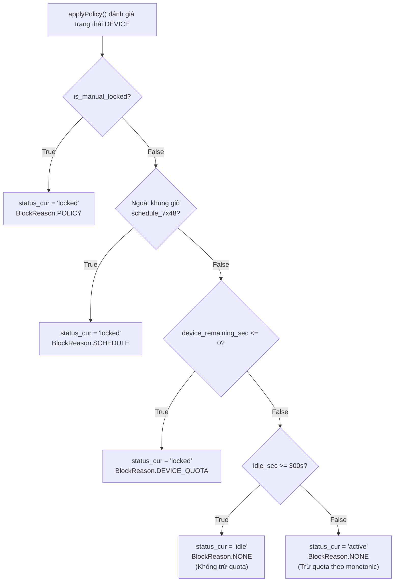
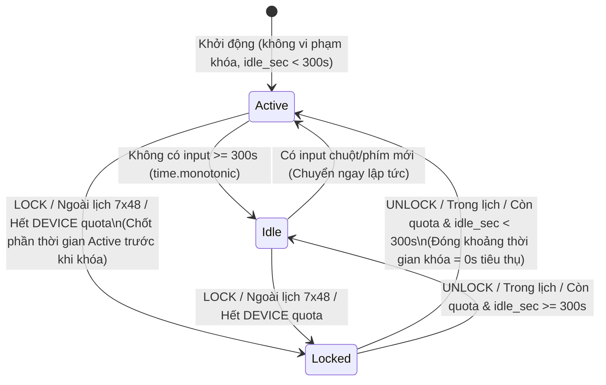

# OGK Engineering Learnings & Design Decisions

> **Tài liệu kỹ thuật nội bộ nhóm OGK**  
> **Mục đích:** Tổng hợp các vấn đề kỹ thuật thực tế phát sinh trong quá trình xây dựng và rà soát hệ thống OGK (Agent trên Windows & Server FastAPI), các quyết định thiết kế đã thống nhất, các bất biến trạng thái (`state invariants`) và các kỹ thuật lập trình hệ thống được áp dụng.  
> **Nguồn đối chiếu xác minh:** [`shared/schemas.py`](file:///c:/Users/Trieu/Computer_Networking/Project/shared/schemas.py), [`server/__init__.py`](file:///c:/Users/Trieu/Computer_Networking/Project/server/__init__.py), [`agent/__init__.py`](file:///c:/Users/Trieu/Computer_Networking/Project/agent/__init__.py), [`tests/test_schemas.py`](file:///c:/Users/Trieu/Computer_Networking/Project/tests/test_schemas.py) và [`REVIEW_SUMMARY.md`](file:///c:/Users/Trieu/Computer_Networking/Project/REVIEW_SUMMARY.md).

---

## 1. Introduction — OGK và mục tiêu kỹ thuật

**OGK** là hệ thống hỗ trợ quản lý thời gian và nội dung sử dụng máy tính của trẻ em trên Windows 10/11 theo nguyên tắc minh bạch, gồm hai thành phần cốt lõi giao tiếp qua mạng:

- **OGK-Agent** ([`agent/__init__.py`](file:///c:/Users/Trieu/Computer_Networking/Project/agent/__init__.py)): Chạy trên máy của trẻ, chịu trách nhiệm áp dụng chính sách (`Policy` — tập quy tắc giới hạn thời gian, lịch sử dụng và danh sách ứng dụng/website), đo thời gian sử dụng thực tế, kiểm tra thao tác người dùng (`Idle`/`Active`) và thực thi lệnh điều khiển từ phụ huynh.
- **OGK-Server** ([`server/__init__.py`](file:///c:/Users/Trieu/Computer_Networking/Project/server/__init__.py)): Dịch vụ trung tâm viết bằng FastAPI, quản lý đăng ký thiết bị (`Enrollment` — ghép đôi thiết bị lần đầu qua mã 8 ký tự), lưu trữ chính sách, tiếp nhận báo cáo định kỳ (`Heartbeat` — gói tin đồng bộ trạng thái mỗi 60 giây) và đẩy lệnh khẩn cấp qua `WebSocket` (kênh kết nối hai chiều duy trì liên tục theo thời gian thực).

Trong quá trình phát triển và thực hiện Code Review đa tác tử (`/review-all`), nhóm nhận thấy phần khó nhất của một hệ thống kiểm soát thời gian không nằm ở việc viết các API CRUD cơ bản, mà nằm ở **tính nhất quán trạng thái phân tán** giữa Server và Agent khi xảy ra các tình huống thực tế:

1. Hai kênh truyền thông bất đồng bộ (`Heartbeat` HTTP định kỳ và `WebSocket` thời gian thực) cùng tác động lên trạng thái khóa máy.
2. Nhiều nguyên nhân khóa máy cùng tồn tại (phụ huynh khóa thủ công, ngoài khung giờ lịch tuần, hết hạn mức thời gian thiết bị).
3. Hạn mức thời gian (`Quota` — ngân sách thời gian được phép sử dụng, tính bằng giây) vừa chịu tác động của cấu hình gốc trong `Policy`, vừa chịu điều chỉnh cộng/trừ (`ADD_TIME`/`SUB_TIME`) và thời gian đã tiêu thụ.
4. Quá trình khởi động lại (`Restart`/`Reboot`) của Agent hoặc Server, sự cố rớt mạng, hoặc hành vi chỉnh lùi đồng hồ hệ thống của người dùng có thể làm sai lệch bộ đếm thời gian nếu chỉ dựa vào đồng hồ hệ thống thông thường.

---

## 2. Engineering Problems — Các vấn đề thực tế

### A. Command handling và Lock state (Finding C-1)

#### 1. Hai kênh nhận lệnh nhưng trùng lặp logic thực thi
Hệ thống duy trì hai phương thức truyền lệnh với vai trò vận hành khác nhau:
- **Kênh `WebSocket` (`/ws/urgent`):** Truyền các lệnh khẩn cấp (`LOCK`, `UNLOCK`, `ADD_TIME`, `SUB_TIME`) đòi hỏi độ trễ thấp (dưới 5 giây) khi Agent đang trực tuyến.
- **Kênh `Heartbeat` (`/api/v1/heartbeat`):** Đóng vai trò kênh đồng bộ định kỳ (mỗi 60 giây) và kênh dự phòng (`fallback` — cơ chế chuyển đổi dự phòng khi kênh chính gặp sự cố) cho các lệnh `LOCK`/`UNLOCK` lưu trong `pending_commands` khi kết nối `WebSocket` bị đứt.

Ở phiên bản trước khi sửa C-1, logic xử lý lệnh `LOCK`/`UNLOCK` bị viết lặp lại ở hai nơi độc lập: một nhánh trong [`HeartbeatResponseHanlder()`](file:///c:/Users/Trieu/Computer_Networking/Project/agent/__init__.py#L475-L511) và một nhánh trong hàm xử lý lệnh khẩn. Việc nhân đôi logic nghiệp vụ (`duplicate implementation`) dẫn đến nguy cơ khi cập nhật quy tắc khóa máy ở một kênh thì kênh còn lại bị lệch hành vi.

#### 2. Nguy cơ `applyPolicy()` vô tình ghi đè trạng thái khóa thủ công của phụ huynh
Thiết bị có thể bị khóa bởi 3 nguyên nhân khác nhau (định nghĩa tại [`BlockReason`](file:///c:/Users/Trieu/Computer_Networking/Project/shared/schemas.py#L36-L43)):
- `BlockReason.POLICY`: Phụ huynh chủ động khóa máy thủ công (`manual lock`) qua lệnh `LOCK`.
- `BlockReason.SCHEDULE`: Thời điểm hiện tại nằm ngoài khung giờ cho phép trong ma trận lịch tuần `schedule_7x48` (7 ngày $\times$ 48 khung 30 phút).
- `BlockReason.DEVICE_QUOTA`: Thiết bị đã dùng hết ngân sách thời gian trong ngày (`automatic lock` do cạn quota).

**Lỗi thực tế đã gặp:** Trước khi có cờ trạng thái riêng cho khóa thủ công, lệnh `LOCK` chỉ gán `status_cur = "locked"` và `device_block_reason = BlockReason.POLICY`. Ngay ở nhịp `Heartbeat` kế tiếp (hoặc khi phụ huynh cộng giờ cho một ứng dụng làm [`applyPolicy()`](file:///c:/Users/Trieu/Computer_Networking/Project/agent/__init__.py#L301-L438) chạy lại), hàm `applyPolicy()` kiểm tra thấy thiết bị vẫn nằm trong khung giờ `schedule_7x48` và chưa hết `DEVICE_QUOTA`, nên rơi vào nhánh `else` và **tự động mở khóa lại máy (`status_cur = "active"`)**, vô hiệu hóa lệnh khóa của phụ huynh. Ngược lại, khi phụ huynh gửi lệnh `UNLOCK`, nếu code chỉ gán thẳng `status_cur = "active"` mà không kiểm tra lại `applyPolicy()`, máy sẽ mở khóa cả khi đang trong giờ cấm của `SCHEDULE` hoặc đã cạn `DEVICE_QUOTA`.

---

### B. Quota accounting — Hạch toán thời gian cộng/trừ (Finding C-2)

#### 1. Vấn đề chặn dưới (`clamp` — giới hạn giá trị không vượt quá ngưỡng) sai vị trí đối với `SUB_TIME`
Đối với từng ứng dụng (`APP`) và tên miền (`WEB`), hạn mức thời gian có cấu trúc gồm 3 thành phần:
- `policy_quota`: Hạn mức gốc quy định trong [`AppRule`](file:///c:/Users/Trieu/Computer_Networking/Project/shared/schemas.py#L124-L128) hoặc [`DomainRule`](file:///c:/Users/Trieu/Computer_Networking/Project/shared/schemas.py#L131-L135).
- `total_adjustment`: Tổng lượng thời gian phụ huynh điều chỉnh qua các lệnh `ADD_TIME` (`+bonus_time`) và `SUB_TIME` (`-sub_time`), lưu trong `app_bonus_time` và `web_bonus_time`.
- `used_time`: Thời gian thực tế trẻ đã sử dụng trong chu kỳ, lưu trong `quota_used`.

**Lỗi thực tế đã gặp:** Ở phiên bản cũ, khi nhận lệnh `SUB_TIME`, cả Server và Agent đều tính `app_bonus_time[a_name] = max(0, app_bonus_time.get(a_name, 0) - cmd.sub_time)`. Việc chặn dưới biến điều chỉnh ở `0` khiến phụ huynh chỉ trừ được phần giờ thưởng thêm trước đó, chứ **không thể trừ lẹm vào hạn mức gốc (`policy_quota`)**. Ví dụ: `roblox.exe` có `policy_quota = 600s`, trẻ chưa được thưởng thêm phút nào (`adjustment = 0`) và đã dùng `100s`; khi phụ huynh gửi `SUB_TIME = 250s`, công thức cũ tính `max(0, 0 - 250) = 0`, làm thời gian còn lại vẫn giữ nguyên `500s` thay vì giảm xuống `250s`.

#### 2. Bảo toàn trạng thái khi `Policy` cập nhật phiên bản mới
Khi phụ huynh thay đổi cấu hình trên Dashboard (tăng hoặc giảm `policy_quota`), Agent tải `Policy` mới khi phát hiện `latest_policy_version > cur_policy_version`. Nếu hệ thống gán đè hoặc xóa `total_adjustment` và `used_time`, phần thời gian trẻ đã dùng hoặc phần giờ phụ huynh vừa thưởng/phạt trong ngày sẽ bị mất hoặc bị tính trùng.

---

### C. DEVICE quota lifecycle — Vòng đời hạn mức thiết bị (Finding C-3)

#### 1. Bẫy giá trị `0` của `device_unlocked_until`
Ban đầu, hạn mức toàn thiết bị được biểu diễn bằng mốc thời gian mở khóa `device_unlocked_until` (mặc định khởi tạo bằng `0`). Trong [`applyPolicy()`](file:///c:/Users/Trieu/Computer_Networking/Project/agent/__init__.py#L301-L438) từng tồn tại đoạn kiểm tra:
```python
if device_unlocked_until == 0 :
    device_unlocked_until = int(time.time()) + limit_sec
```
**Lỗi thực tế đã gặp:**
- Khi phụ huynh gửi lệnh `SUB_TIME` lớn làm `device_unlocked_until = max(0, device_unlocked_until - cmd.sub_time)` chạm mốc `0`, lệnh gọi `applyPolicy()` ngay sau đó hiểu nhầm `0` là "thiết bị mới khởi động lần đầu chưa được cấp quota", dẫn đến việc **tự động cấp mới lại toàn bộ hạn mức ngày (`limit_sec`)** thay vì khóa máy.
- Tương tự, khi Agent khởi động lại trong ngày (`device_unlocked_until` trong RAM về `0`) hoặc khi [`HeartbeatResponseHanlder()`](file:///c:/Users/Trieu/Computer_Networking/Project/agent/__init__.py#L475-L511) dùng điều kiện `if data.device_unlocked_until > 0:` (bỏ qua giá trị `0` từ Server trả về), thiết bị đã cạn hạn mức sẽ tự mở khóa lại hoặc không đồng bộ được trạng thái hết giờ từ Server.

#### 2. Sai lệch khi dùng Wall Clock để đo thời gian sử dụng và nguy cơ từ Reboot
- Nếu chỉ dùng đồng hồ hệ thống (`Wall clock` — thời gian thực tế theo lịch ngày/giờ của hệ điều hành, lấy qua `time.time()`) để so sánh hạn mức, khi người dùng chỉnh lùi đồng hồ hệ thống 3 giờ (`-10800` giây), khoảng cách đến mốc hết hạn sẽ tăng thêm 3 giờ.
- Ngược lại, khi chuyển sang dùng đồng hồ đơn điệu (`Monotonic clock` — bộ đếm thời gian chỉ tiến về phía trước kể từ lúc hệ điều hành khởi động, không bị ảnh hưởng khi chỉnh giờ hệ thống, lấy qua `time.monotonic()`), giá trị tuyệt đối của `time.monotonic()` sẽ bị đặt lại về `0` sau mỗi lần máy tính `Reboot` (khởi động lại hệ điều hành). Nếu lưu trực tiếp mốc `last_mono_ts` xuống file rồi lấy `now_mono - last_mono_ts` sau khi `Reboot`, phép trừ sẽ cho kết quả âm lớn và làm hỏng hoàn toàn dữ liệu hạn mức.

---

### D. Idle / Active và Usage Time — Đếm thời gian sử dụng thực tế (Yêu cầu F1)

Đặc tả chức năng **F1** quy định: *"Đếm thời gian sử dụng thực: không tính khi máy khóa hoặc không có thao tác quá 5 phút"*.

Nếu bộ đếm hạn mức chỉ trừ lùi theo thời gian trôi qua kể từ lúc bật máy:
- Khi trẻ rời khỏi bàn học quá 5 phút (máy không có thao tác bàn phím/chuột — trạng thái `Idle`), thời gian nghỉ vẫn bị trừ vào hạn mức ngày.
- Khi máy đang bị khóa (`Locked` do lệnh `LOCK` của phụ huynh hoặc ngoài khung giờ `SCHEDULE`), hạn mức ngày vẫn tiếp tục hao hụt.
- Khi chuyển tiếp qua lại giữa các trạng thái `Active` $\leftrightarrow$ `Idle` $\leftrightarrow$ `Locked`, nếu không chốt (`flush` — ghi nhận dứt điểm phần dữ liệu đang chờ tính toán) thời gian đã chạy của trạng thái trước khi đổi trạng thái, hệ thống sẽ làm mất số giây `Active` ngay trước thời điểm khóa hoặc tính trùng khoảng thời gian `Idle` vào lần thao tác kế tiếp.

---

## 3. Design Decisions — Các quyết định đã thống nhất

### 3.1. Phân tách kênh truyền lệnh nhưng hợp nhất hàm thực thi [`execCmd()`](file:///c:/Users/Trieu/Computer_Networking/Project/agent/__init__.py#L526-L588)
- **Quyết định:** Giữ nguyên hai kênh nhận lệnh (`Heartbeat` cho đồng bộ định kỳ/dự phòng khi mất kết nối và `WebSocket` cho lệnh khẩn cấp thời gian thực), nhưng mọi lệnh khi tới Agent đều phải đi qua một hàm thực thi duy nhất là [`execCmd(cmd: UrgentCmd)`](file:///c:/Users/Trieu/Computer_Networking/Project/agent/__init__.py#L526-L588).
- **Bảo toàn nguyên nhân khóa (State Priority Invariant):**
  - Tách cờ độc lập `is_manual_locked: bool` ([`agent/__init__.py`](file:///c:/Users/Trieu/Computer_Networking/Project/agent/__init__.py#L126)) chỉ bật khi nhận `CommandType.LOCK` và chỉ tắt khi nhận `CommandType.UNLOCK`.
  - Trong [`applyPolicy()`](file:///c:/Users/Trieu/Computer_Networking/Project/agent/__init__.py#L427-L438), thứ tự ưu tiên đánh giá trạng thái thiết bị luôn cố định:
    1. `is_manual_locked == True` $\rightarrow$ `status_cur = "locked"`, `device_block_reason = BlockReason.POLICY`.
    2. Ngoài khung giờ `schedule_7x48` $\rightarrow$ `status_cur = "locked"`, `device_block_reason = BlockReason.SCHEDULE`.
    3. `device_remaining_sec <= 0` $\rightarrow$ `status_cur = "locked"`, `device_block_reason = BlockReason.DEVICE_QUOTA`.
    4. Không vi phạm các điều kiện khóa trên $\rightarrow$ `device_block_reason = BlockReason.NONE`, xét `status_cur = "idle"` (nếu không thao tác $\ge 300$ giây) hoặc `"active"`.



---

### 3.2. Công thức bất biến cho Quota Accounting (Signed Adjustment)
- **Quyết định:** Xem hạn mức là ngân sách cơ sở (`policy_quota`), các lệnh `ADD_TIME` và `SUB_TIME` cộng/trừ trực tiếp vào biến điều chỉnh có dấu (`total_adjustment` có thể dương hoặc âm). Không chặn dưới `total_adjustment` ở `0`; chỉ chặn dưới kết quả thời gian còn lại (`remain`) ở `0`:
  $$\text{remain} = \max(0,\ \text{policy\_quota} + \text{total\_adjustment} - \text{used\_time})$$
- **Khi cập nhật `Policy` mới:** Chỉ thay thế `policy_quota` mới từ `Policy`, giữ nguyên `total_adjustment` (`app_bonus_time`, `web_bonus_time`) và `used_time` (`quota_used`) của chu kỳ hiện tại rồi tính lại `remain` ([`getAppRemainingQuota()`](file:///c:/Users/Trieu/Computer_Networking/Project/agent/__init__.py#L272-L284), [`getWebRemainingQuota()`](file:///c:/Users/Trieu/Computer_Networking/Project/agent/__init__.py#L287-L298)).
- **Sự khác biệt ngữ nghĩa giữa `APP`/`WEB` quota và `DEVICE` quota trong source code hiện tại:**
  - Với `APP` và `WEB`: Hạn mức được tính trực tiếp từ 3 biến độc lập `r.quota` (`policy_quota`), `app_bonus_time`/`web_bonus_time` (`total_adjustment`) và `quota_used` (`used_time`). Khi hết hạn mức (`remain == 0`), Agent chỉ chặn tên miền hoặc kết thúc tiến trình vi phạm, không khóa toàn thiết bị.
  - Với `DEVICE`: Ngân sách thời gian còn lại được quản lý qua `device_remaining_sec` và thời gian đã dùng `device_quota_used` (`quota_used["__device__"]`), đồng thời duy trì đồng bộ hai chiều với mốc `device_unlocked_until` để tương thích với giao thức `HeartbeatResponse`. Khi `device_remaining_sec <= 0` (`device_unlocked_until == 0`), toàn bộ thiết bị chuyển sang trạng thái `"locked"` với `BlockReason.DEVICE_QUOTA`.

---

### 3.3. Chu kỳ DEVICE Quota theo ngày và phối hợp hai loại Clock
- **Quyết định thiết kế của nhóm về thời điểm reset 00:00 (UTC+7):**
  > [!IMPORTANT]
  > Đặc tả ban đầu của môn học chỉ nêu *"Hạn mức theo ngày (ví dụ 90 phút), cấu hình riêng cho ngày thường và cuối tuần"*, không quy định cứng giờ phút chuyển giao ngày hay múi giờ. Nhóm đã thống nhất **quyết định thiết kế kỹ thuật**: chu kỳ `DEVICE` quota được tính theo ngày lịch và **reset đúng một lần vào lúc 00:00 giờ Việt Nam (`UTC+7`, định nghĩa bởi hằng số `VN_TZ = timezone(timedelta(hours = 7))`)**.
- **Quy tắc duy trì khóa và chống reset lặp:**
  - Lưu kèm ngày lịch của chu kỳ hiện tại `device_quota_date` (`YYYY-MM-DD` theo giờ Việt Nam) trên cả Server ([`device_quota_date_store`](file:///c:/Users/Trieu/Computer_Networking/Project/server/__init__.py#L58)) và Agent ([`device_quota_date`](file:///c:/Users/Trieu/Computer_Networking/Project/agent/__init__.py#L115)).
  - Chỉ khi ngày lịch hiện tại lớn hơn ngày đã lưu (`today_str > saved_date`), hệ thống mới cấp lại hạn mức ngày mới theo `weekday_quota` hoặc `weekend_quota` của `Policy` hiện hành, đặt lại `device_quota_used = 0` và lưu ngay `device_quota_date = today_str` xuống file.
  - Mọi trường hợp trong cùng ngày (`today_str == saved_date`) hoặc khi đồng hồ bị chỉnh lùi về ngày cũ (`today_str < saved_date`), hệ thống giữ nguyên hạn mức hiện có. Nếu `device_remaining_sec == 0` (`device_unlocked_until == 0`), thiết bị tiếp tục bị khóa cho đến `00:00` ngày kế tiếp; `Heartbeat`, Server restart hay Agent restart trong cùng ngày đều không cấp lại quota.
- **Phân vai giữa Wall Clock và Monotonic Clock:**
  - **Wall clock (`time.time()` quy đổi sang `VN_TZ`):** Chỉ dùng để xác định ngày lịch Việt Nam (`YYYY-MM-DD`), thứ trong tuần (`weekday()`), khung giờ `schedule_7x48` và đối chiếu độ lệch đồng hồ.
  - **Monotonic clock (`time.monotonic()` — tương đương với `std::chrono::steady_clock` trong C++):** Dùng để đo khoảng thời gian trôi qua giữa các nhịp kiểm tra (`mono_delta`), thời gian thiết bị thực sự hoạt động (`device_quota_used`), thời gian đếm ngược (`device_remaining_sec`) và khoảng thời gian không thao tác (`idle_sec`).
  - **Persistence & Recovery qua Reboot:** Tuyệt đối không lưu `last_mono_ts` xuống đĩa. Khi lưu trạng thái ([`saveAgentQuotaState()`](file:///c:/Users/Trieu/Computer_Networking/Project/agent/__init__.py#L211-L225)), Agent chỉ lưu số giây còn lại `device_remaining_sec`, số giây đã dùng `device_quota_used` và `device_quota_date`. Khi khôi phục sau `Reboot` ([`loadAgentQuotaState()`](file:///c:/Users/Trieu/Computer_Networking/Project/agent/__init__.py#L228-L269)) hoặc khi phát hiện `now_mono < last_mono_ts`, Agent hủy bỏ mốc monotonic cũ và khởi tạo lại mốc monotonic mới từ phiên chạy hiện tại.

---

### 3.4. Máy trạng thái Idle / Active và đo thời gian thao tác
- **Quyết định:**
  - Sử dụng hàm API của Windows `user32.GetLastInputInfo` ([`getWindowsInputInfo()`](file:///c:/Users/Trieu/Computer_Networking/Project/agent/__init__.py#L154-L165)) để phát hiện sự thay đổi của `dwTime` (thời điểm có thao tác bàn phím/chuột cuối cùng), từ đó neo sang mốc `last_input_mono` trên đồng hồ đơn điệu (`time.monotonic()`).
  - Khoảng thời gian không thao tác được tính bằng `idle_sec = now_mono - last_input_mono`:
    - Có thao tác mới (`idle_sec < 300s`) và máy không bị khóa $\rightarrow$ chuyển sang `Active` (`status_cur = "active"`) ngay lập tức, không có độ trễ xác nhận.
    - Không có thao tác từ 5 phút trở lên (`idle_sec >= 300s`) $\rightarrow$ chuyển sang `Idle` (`status_cur = "idle"`), ngừng trừ `device_remaining_sec`.
    - Máy đang ở trạng thái `Locked` (`status_cur == "locked"`) $\rightarrow$ không trừ `device_remaining_sec` bất kể có thao tác bàn phím/chuột hay không.



---

## 4. Techniques Used — Các khái niệm Systems Engineering xuyên suốt

### 4.1. Data Integrity và Data Loss (Toàn vẹn dữ liệu và chống mất dữ liệu)
- **Vấn đề thực tế:** Khi Agent gửi danh sách mã lệnh đã xử lý (`acked_commands`) lên Server qua `Heartbeat`, nếu xóa danh sách này trước khi HTTP request thành công hoặc nếu Server mất toàn bộ trạng thái điều chỉnh giờ trong RAM khi khởi động lại, dữ liệu xác nhận lệnh và thời gian thưởng/phạt sẽ bị mất. Ngoài ra, khi chuyển trạng thái từ `Active` sang `Locked`, nếu không chốt phần thời gian vừa dùng trước khi khóa, số giây `Active` đó sẽ bị mất.
- **Nguyên nhân có thể gây lỗi:** Xóa bộ đệm trước khi nhận phản hồi thành công từ mạng; chỉ lưu trạng thái trong bộ nhớ khả biến (RAM); đổi cờ trạng thái trước khi cộng dồn bộ đếm thời gian.
- **Cách OGK xử lý / dự kiến xử lý:**
  - Trong [`requestHeartbeat()`](file:///c:/Users/Trieu/Computer_Networking/Project/agent/__init__.py#L455-L473), chỉ gọi `acked_commands.clear()` sau khi `response.raise_for_status()` xác nhận HTTP 200.
  - Trong [`execCmd()`](file:///c:/Users/Trieu/Computer_Networking/Project/agent/__init__.py#L526-L588) và [`recordUserInput()`](file:///c:/Users/Trieu/Computer_Networking/Project/agent/__init__.py#L194-L209), luôn chốt (`flush`) thời gian `Active` đã chạy trước khi chuyển sang `Locked` hoặc cập nhật mốc mới.
  - Lưu trạng thái quota xuống `quota_state.json` trên Server và `agent_quota_state.json` trên Agent. *(Lưu ý: Việc ghi file nguyên tử bằng file tạm + `os.replace` đã được nhận diện trong Finding S-3 để nâng cấp tiếp).*
- **Kỹ thuật được áp dụng:** Clear-after-ACK, State flushing before transition, File-backed state persistence.
- **Bài học cho dự án khác:** Không bao giờ xóa dữ liệu trong hàng đợi gửi đi trước khi bên nhận xác nhận đã lưu thành công, và luôn chốt bộ đếm tích lũy tại ranh giới chuyển trạng thái.

### 4.2. Concurrency và Race Conditions (Xử lý đồng thời và điều kiện tranh chấp)
- **Vấn đề thực tế:**
  1. Trên Server, khi một thiết bị rớt mạng và kết nối lại `WebSocket` nhanh, kết nối mới có thể ghi vào `active_ws_connections[device_id]` trước khi khối `finally` của kết nối cũ kịp chạy xong. Nếu khối `finally` cũ gọi `active_ws_connections.pop(device_id)` vô điều kiện, nó sẽ xóa nhầm kết nối mới đang hoạt động (Finding S-2).
  2. Trên Agent, nếu [`UrgentCmdHandler()`](file:///c:/Users/Trieu/Computer_Networking/Project/agent/__init__.py#L595-L649) được gọi lặp nhiều lần trên vòng lặp sự kiện bất đồng bộ (`asyncio`), nhiều trình lắng nghe `WebSocket` sẽ chạy song song và xử lý trùng một lệnh.
- **Nguyên nhân có thể gây lỗi:** Nhiều `coroutine` (hàm bất đồng bộ `async def` có thể tạm dừng và tiếp tục trên event loop) cùng đọc/ghi một cấu trúc dữ liệu dùng chung (`active_ws_connections`, `ws_handler_running`) mà không kiểm tra định danh đối tượng.
- **Cách OGK xử lý:**
  - Trong [`urgentWebsocketEndpoint()`](file:///c:/Users/Trieu/Computer_Networking/Project/server/__init__.py#L283-L306) và [`sendUrgentCmd()`](file:///c:/Users/Trieu/Computer_Networking/Project/server/__init__.py#L364-L373), sử dụng kiểm tra định danh tham chiếu `if active_ws_connections.get(device_id) is websocket:` trước khi `pop`.
  - Trên Agent, dùng cờ khóa `ws_handler_running` bọc trong `try...finally` để đảm bảo chỉ có duy nhất một tiến trình lắng nghe `WebSocket` hoạt động tại một thời điểm.
- **Kỹ thuật được áp dụng:** Identity-checked cleanup (`Compare-and-Delete`), Single-instance execution guard.
- **Bài học cho dự án khác:** Trong lập trình mạng bất đồng bộ, khi dọn dẹp tài nguyên trong `finally`, luôn kiểm tra xem tài nguyên đang lưu trong bảng toàn cục có còn đúng là thực thể (`instance`) của kết nối vừa đóng hay không.

### 4.3. Separation of Concerns (Phân tách trách nhiệm)
- **Vấn đề thực tế:** Tầng truyền vận lệnh (`WebSocket` nhận JSON tức thời vs `Heartbeat` nhận danh sách chuỗi lệnh chờ) có cơ chế mạng khác nhau, nhưng nghiệp vụ thay đổi trạng thái thiết bị (`LOCK`, `UNLOCK`, `ADD_TIME`, `SUB_TIME`) là một.
- **Nguyên nhân có thể gây lỗi:** Trộn lẫn code đọc/ghi socket hoặc parse chuỗi lệnh với code thay đổi biến trạng thái thiết bị.
- **Cách OGK xử lý:** Tách riêng tầng giao tiếp mạng ([`UrgentCmdHandler()`](file:///c:/Users/Trieu/Computer_Networking/Project/agent/__init__.py#L595-L649), [`HeartbeatResponseHanlder()`](file:///c:/Users/Trieu/Computer_Networking/Project/agent/__init__.py#L475-L511)) khỏi tầng thực thi nghiệp vụ ([`execCmd()`](file:///c:/Users/Trieu/Computer_Networking/Project/agent/__init__.py#L526-L588)) và tầng đánh giá chính sách ([`applyPolicy()`](file:///c:/Users/Trieu/Computer_Networking/Project/agent/__init__.py#L301-L438)).
- **Kỹ thuật được áp dụng:** Separation of transport layer and domain execution logic.
- **Bài học cho dự án khác:** Mọi kênh giao tiếp (HTTP, WebSocket, Queue) chỉ nên làm nhiệm vụ giải mã dữ liệu về một cấu trúc lệnh chuẩn (`UrgentCmd`), sau đó chuyển giao cho một hàm xử lý nghiệp vụ duy nhất.

### 4.4. State Invariants và State Transitions (Bất biến trạng thái và chuyển đổi trạng thái)
- **Vấn đề thực tế:** Trạng thái `status_cur` (`"active"`, `"idle"`, `"locked"`) và `device_block_reason` chịu sự chi phối đồng thời của lệnh phụ huynh, lịch tuần, hạn mức ngày và thao tác chuột/bàn phím.
- **Nguyên nhân có thể gây lỗi:** Gán trực tiếp `status_cur = "active"` hoặc `"locked"` rời rạc ở nhiều hàm mà không duy trì thứ tự ưu tiên giữa các nguyên nhân khóa.
- **Cách OGK xử lý:** Thiết lập bất biến trạng thái: `Locked (POLICY > SCHEDULE > DEVICE_QUOTA) > Idle > Active`. Khi nhận lệnh `UNLOCK`, Agent chỉ hạ cờ `is_manual_locked = False` rồi bắt buộc gọi [`applyPolicy()`](file:///c:/Users/Trieu/Computer_Networking/Project/agent/__init__.py#L541-L548) để đánh giá lại toàn bộ các điều kiện khóa còn lại.
- **Kỹ thuật được áp dụng:** Hierarchical state evaluation, Explicit state flags (`is_manual_locked`).
- **Bài học cho dự án khác:** Khi một thực thể có thể bị khóa/chặn bởi nhiều nguồn độc lập, không lưu trạng thái bằng một biến chuỗi đơn lẻ mà phải lưu trạng thái của từng nguồn và tổng hợp lại qua một hàm đánh giá có thứ tự ưu tiên cố định.

### 4.5. Resource Accounting (Hạch toán tài nguyên)
- **Vấn đề thực tế:** Thời gian sử dụng là một loại tài nguyên hữu hạn có ngân sách cơ sở (`policy_quota`), có cấp thêm/thu hồi (`ADD_TIME`/`SUB_TIME`) và có tiêu thụ (`used_time`).
- **Nguyên nhân có thể gây lỗi:** Gộp chung điều chỉnh thời gian vào hạn mức gốc của `Policy` hoặc chặn dưới biến điều chỉnh ở `0` làm mất khả năng thu hồi vào ngân sách gốc.
- **Cách OGK xử lý:** Sử dụng kế toán có dấu (`signed adjustment`): giữ bất biến `policy_quota` từ `Policy`, cho phép `total_adjustment` nhận cả giá trị dương và âm, và chỉ chặn dưới tại bước tính lượng tài nguyên còn lại `remain = max(0, policy_quota + total_adjustment - used_time)`.
- **Kỹ thuật được áp dụng:** Signed delta accounting, Immutable base policy with overlay adjustments.
- **Bài học cho dự án khác:** Trong các bài toán quản lý hạn mức (quota, tín dụng, tồn kho), hãy tách biệt 3 đại lượng: *Hạn mức gốc (Base)*, *Tổng điều chỉnh có dấu (Signed Adjustment)* và *Lượng đã tiêu thụ (Consumed)* thay vì cộng/trừ đè lên cùng một biến.

### 4.6. Persistence và Recovery (Lưu trữ bền vững và khôi phục sau sự cố)
- **Vấn đề thực tế:** Khi Server hoặc Agent khởi động lại giữa ngày, nếu không lưu ngày của chu kỳ hiện tại và lượng quota còn lại, hệ thống sẽ cấp lại toàn bộ quota ngày hoặc làm mất trạng thái hết giờ (`device_unlocked_until == 0`).
- **Nguyên nhân có thể gây lỗi:** Dùng giá trị `0` vừa làm giá trị mặc định lúc chưa khởi tạo, vừa làm giá trị khi đã cạn sạch quota; hoặc lưu các giá trị phụ thuộc phiên chạy (như `time.monotonic()`) xuống đĩa.
- **Cách OGK xử lý:** Lưu kèm `device_quota_date` (`YYYY-MM-DD` theo giờ Việt Nam `UTC+7`), `device_remaining_sec`, `device_quota_used` và `device_unlocked_until`. Khi khôi phục, đối chiếu `today_str` với `saved_date`: cùng ngày thì giữ nguyên trạng thái (kể cả khi còn `0` giây), sang ngày mới (`today_str > saved_date`) mới cấp lại theo `Policy` và ghi nhận ngay xuống đĩa để không reset lần thứ hai.
- **Kỹ thuật được áp dụng:** Cycle-date tagged persistence, Reboot-safe state serialization.
- **Bài học cho dự án khác:** Mọi dữ liệu hạn mức theo chu kỳ thời gian (giờ/ngày/tháng) khi lưu xuống đĩa phải luôn đi kèm định danh của chu kỳ đó (`cycle_id` / `quota_date`) để phân biệt giữa "khôi phục trong cùng chu kỳ" và "bước sang chu kỳ mới".

### 4.7. Wall Clock vs Monotonic Clock (Đồng hồ hệ thống và đồng hồ đơn điệu)
- **Vấn đề thực tế:** Trẻ có thể chỉnh lùi đồng hồ Windows để kéo dài thời gian sử dụng nếu hệ thống dùng `time.time()` để đo thời gian trôi qua.
- **Nguyên nhân có thể gây lỗi:** `Wall clock` (`time.time()`) có thể nhảy lùi hoặc nhảy tiến do người dùng chỉnh tay hoặc do đồng bộ NTP (`Network Time Protocol` — giao thức đồng bộ thời gian mạng).
- **Cách OGK xử lý:**
  - Dùng `Wall clock` theo múi giờ `UTC+7` ([`getVnNow()`](file:///c:/Users/Trieu/Computer_Networking/Project/agent/__init__.py#L146-L147)) chỉ để xác định mốc lịch ngày (`00:00`) và khung lịch `schedule_7x48`.
  - Dùng `Monotonic clock` (`time.monotonic()`) để đo mọi khoảng thời gian trôi qua (`elapsed time`, `idle_sec`, `device_remaining_sec`).
  - Đối chiếu độ lệch `(now_wall - last_wall_ts) - (now_mono - last_mono_ts) < -30s` để phát hiện hành vi chỉnh lùi đồng hồ và ghi nhận [`EventRecord`](file:///c:/Users/Trieu/Computer_Networking/Project/shared/schemas.py#L53-L65) (`subject = "clock_tamper"`).
- **Kỹ thuật được áp dụng:** Dual-clock timekeeping, Clock skew/tamper detection.
- **Bài học cho dự án khác:** Quy tắc vàng trong lập trình hệ thống: dùng `Wall clock` khi cần trả lời *"Bây giờ là mấy giờ, ngày nào?"* và dùng `Monotonic clock` (`time.monotonic()` / `steady_clock`) khi cần trả lời *"Đã bao nhiêu giây trôi qua kể từ mốc A?"*.

### 4.8. Failure Handling (Xử lý lỗi và suy giảm an toàn)
- **Vấn đề thực tế:** Kết nối `WebSocket` giữa Agent và Server có thể đứt bất ngờ, hoặc gói tin JSON nhận được bị hỏng định dạng.
- **Nguyên nhân có thể gây lỗi:** Không bắt ngoại lệ khi gọi `ws.send_json()` trên Server hoặc `json.loads()` trên Agent khiến vòng lặp lắng nghe bị dừng hẳn.
- **Cách OGK xử lý:**
  - Trên Server ([`sendUrgentCmd()`](file:///c:/Users/Trieu/Computer_Networking/Project/server/__init__.py#L364-L379)): bọc `await ws.send_json(...)` trong `try...except`; nếu gửi lỗi thì xóa kết nối `stale` (kết nối đã đứt ngầm) và tự động chuyển lệnh `LOCK`/`UNLOCK` sang hàng đợi `pending_cmds_store` để đồng bộ qua `Heartbeat`.
  - Trên Agent ([`UrgentCmdHandler()`](file:///c:/Users/Trieu/Computer_Networking/Project/agent/__init__.py#L595-L649)): tách riêng `try...except` cho bước giải mã JSON (bỏ qua gói tin lỗi mà không ngắt kết nối) và áp dụng `Exponential backoff` (tăng dần thời gian chờ kết nối lại theo lũy thừa `min(max_delay, base_delay * 2^(attempt-1))`) khi mất kết nối mạng.
- **Kỹ thuật được áp dụng:** Graceful degradation (WebSocket-to-Heartbeat fallback), Exponential backoff reconnection, Fault-isolated message parsing.
- **Bài học cho dự án khác:** Luôn thiết kế đường lùi (`fallback`) khi kênh thời gian thực gặp sự cố, và tách biệt lỗi dữ liệu của một bản tin đơn lẻ khỏi lỗi kết nối của toàn kênh truyền.

### 4.9. Idempotency (Tính lũy đẳng — thực thi nhiều lần cho cùng kết quả như một lần)
- **Vấn đề thực tế:** Khi mạng chập chờn, Server có thể gửi lại cùng một mã lệnh trong `pending_commands` qua nhiều nhịp `Heartbeat`, hoặc Agent gửi lại danh sách sự kiện khi đồng bộ ngoại tuyến.
- **Nguyên nhân có thể gây lỗi:** Thực thi lặp một lệnh hoặc cộng trùng thời lượng sử dụng của cùng một sự kiện.
- **Cách OGK xử lý:**
  - Đối với lệnh điều khiển qua `Heartbeat`: Agent lưu tập các mã lệnh đã thực thi trong `executed_cmds: set[str]` ([`agent/__init__.py`](file:///c:/Users/Trieu/Computer_Networking/Project/agent/__init__.py#L136)) và chỉ gọi `execCmd()` nếu `cmd not in executed_cmds`, sau đó gửi lại mã lệnh qua `acked_commands` để Server xóa khỏi hàng đợi. *(Lưu ý: Cách sinh mã `cmd_id` trên Server hiện dùng `f"{int(time.time())}:{cmd.cmd_type}"`, đã được ghi nhận tại Finding C-4 cần nâng cấp sang UUID để tránh trùng trong cùng 1 giây).*
  - Đối với bản ghi sự kiện ([`EventState` / `EventRecord`](file:///c:/Users/Trieu/Computer_Networking/Project/shared/schemas.py#L53-L65)): Schema đã định nghĩa trường bắt buộc `idempotency_key` (chuỗi UUID duy nhất) cho mỗi sự kiện phát sinh.
- **Kỹ thuật được áp dụng:** Client-side deduplication set (`executed_cmds`), ACK-based queue removal, Event `idempotency_key`.
- **Bài học cho dự án khác:** Trong mạng không tin cậy, cơ chế truyền tin chuẩn thường là *At-least-once delivery* (gửi ít nhất một lần cho đến khi nhận được ACK); muốn đạt hiệu quả *Exactly-once processing* (xử lý đúng một lần), bên nhận bắt buộc phải kiểm tra khóa chống trùng (`idempotency_key` / `cmd_id`).

---

## 5. Implementation & Verification Status — Trạng thái triển khai và kiểm thử

Bảng dưới đây đối chiếu trực tiếp từng hạng mục kỹ thuật với source code hiện tại và bộ kiểm thử tự động trong [`tests/test_schemas.py`](file:///c:/Users/Trieu/Computer_Networking/Project/tests/test_schemas.py) (10/10 bài kiểm thử đang `PASSED`):

| Hạng mục kỹ thuật | Đã thống nhất thiết kế | Đã triển khai trong Source Code | Đã kiểm chứng bằng Unit Test | Vị trí xác minh trong Repository |
| :--- | :---: | :---: | :---: | :--- |
| **Xác thực `/api/v1/urgent` (`PARENT_TOKEN`, `device_id`) — S-1** | Có | Có | Có | [`server/__init__.py`](file:///c:/Users/Trieu/Computer_Networking/Project/server/__init__.py#L309-L326), [`test_urgent_auth_and_device_validation_s1`](file:///c:/Users/Trieu/Computer_Networking/Project/tests/test_schemas.py#L210-L236) |
| **Dọn kết nối WebSocket an toàn & Reconnect Backoff — S-2** | Có | Có | Có | [`server/__init__.py`](file:///c:/Users/Trieu/Computer_Networking/Project/server/__init__.py#L283-L306), [`agent/__init__.py`](file:///c:/Users/Trieu/Computer_Networking/Project/agent/__init__.py#L595-L649), [`test_websocket_cleanup_and_reconnection_s2`](file:///c:/Users/Trieu/Computer_Networking/Project/tests/test_schemas.py#L238-L352) |
| **Hợp nhất `execCmd()` & Bảo toàn Manual Lock (`is_manual_locked`) — C-1** | Có | Có | Có | [`agent/__init__.py`](file:///c:/Users/Trieu/Computer_Networking/Project/agent/__init__.py#L126), [`applyPolicy()`](file:///c:/Users/Trieu/Computer_Networking/Project/agent/__init__.py#L427-L438), [`execCmd()`](file:///c:/Users/Trieu/Computer_Networking/Project/agent/__init__.py#L526-L548), [`test_manual_lock_preservation_and_shared_cmd_semantics_c1`](file:///c:/Users/Trieu/Computer_Networking/Project/tests/test_schemas.py#L354-L451) |
| **Hạch toán `SUB_TIME` âm (`remain = max(0, policy_quota + adj - used)`) — C-2** | Có | Có | Có | [`server/__init__.py`](file:///c:/Users/Trieu/Computer_Networking/Project/server/__init__.py#L346-L361), [`agent/__init__.py`](file:///c:/Users/Trieu/Computer_Networking/Project/agent/__init__.py#L272-L298), [`test_sub_time_negative_adjustment_and_policy_update_c2`](file:///c:/Users/Trieu/Computer_Networking/Project/tests/test_schemas.py#L453-L630) |
| **Chu kỳ DEVICE Quota 00:00 (UTC+7), xử lý `device_unlocked_until == 0` — C-3** | Có | Có | Có | [`server/__init__.py`](file:///c:/Users/Trieu/Computer_Networking/Project/server/__init__.py#L65-L168), [`agent/__init__.py`](file:///c:/Users/Trieu/Computer_Networking/Project/agent/__init__.py#L355-L425), [`test_device_quota_daily_cycle_and_zero_handling_c3`](file:///c:/Users/Trieu/Computer_Networking/Project/tests/test_schemas.py#L632-L783) |
| **Đo thời gian bằng Monotonic Clock, phát hiện lùi đồng hồ & Recovery sau Reboot — C-3/F1** | Có | Có | Có | [`agent/__init__.py`](file:///c:/Users/Trieu/Computer_Networking/Project/agent/__init__.py#L211-L269), [`applyPolicy()`](file:///c:/Users/Trieu/Computer_Networking/Project/agent/__init__.py#L351-L388), [`test_clock_monotonic_elapsed_tamper_and_reboot_recovery_c3`](file:///c:/Users/Trieu/Computer_Networking/Project/tests/test_schemas.py#L785-L857) |
| **Theo dõi Input (`GetLastInputInfo` + Monotonic) & chuyển trạng thái Idle/Active — F1** | Có | Có | Có | [`agent/__init__.py`](file:///c:/Users/Trieu/Computer_Networking/Project/agent/__init__.py#L139-L209), [`test_idle_active_state_transitions_and_quota_accounting_c3`](file:///c:/Users/Trieu/Computer_Networking/Project/tests/test_schemas.py#L859-L957) |
| **Mã lệnh `cmd_id` dùng UUID chống trùng trong cùng 1 giây — Finding C-4** | Đã có trong Review | **Chưa triển khai** *(đang dùng `int(time.time()):cmd_type`)* | Chưa có | [`server/__init__.py`](file:///c:/Users/Trieu/Computer_Networking/Project/server/__init__.py#L376), [`REVIEW_SUMMARY.md`](file:///c:/Users/Trieu/Computer_Networking/Project/REVIEW_SUMMARY.md#L114-L121) |
| **Tách cập nhật nhẹ theo `target_type` (tránh quét `psutil` toàn cục) — Finding P-1** | Đã có trong Review | **Chưa triển khai** | Chưa có | [`agent/__init__.py`](file:///c:/Users/Trieu/Computer_Networking/Project/agent/__init__.py#L342-L349), [`REVIEW_SUMMARY.md`](file:///c:/Users/Trieu/Computer_Networking/Project/REVIEW_SUMMARY.md#L138-L145) |
| **Đặt `attempt = 0` sau `websocket.recv()` & giới hạn kích thước bộ nhớ ACK — Finding P-2** | Đã có trong Review | **Chưa triển khai** *(đang đặt trước `recv()`)* | Chưa có | [`agent/__init__.py`](file:///c:/Users/Trieu/Computer_Networking/Project/agent/__init__.py#L615-L617), [`REVIEW_SUMMARY.md`](file:///c:/Users/Trieu/Computer_Networking/Project/REVIEW_SUMMARY.md#L148-L165) |
| **Ghi file nguyên tử (`os.replace`), lọc tiến trình hệ thống khi `proc.kill()`, `secrets.compare_digest` — Finding S-3** | Đã có trong Review | **Chưa triển khai** | Chưa có | [`server/__init__.py`](file:///c:/Users/Trieu/Computer_Networking/Project/server/__init__.py#L117), [`agent/__init__.py`](file:///c:/Users/Trieu/Computer_Networking/Project/agent/__init__.py#L347), [`REVIEW_SUMMARY.md`](file:///c:/Users/Trieu/Computer_Networking/Project/REVIEW_SUMMARY.md#L172-L179) |
| **Đồng bộ `event_buffer` và bộ đếm `quota_used` của từng App/Web theo thời gian thực lên Server** | Đã có trong đặc tả F1/F3 | **Một phần** *(Đã có `event_buffer` và schema `EventRecord`, chưa có endpoint `/events` đồng bộ lô và vòng lặp đo từng process/domain)* | Mới kiểm thử qua dữ liệu/mock | [`shared/schemas.py`](file:///c:/Users/Trieu/Computer_Networking/Project/shared/schemas.py#L53-L65), [`agent/__init__.py`](file:///c:/Users/Trieu/Computer_Networking/Project/agent/__init__.py#L124), [`REVIEW_SUMMARY.md`](file:///c:/Users/Trieu/Computer_Networking/Project/REVIEW_SUMMARY.md#L190-L194) |

---

## 6. Lessons Learned — Bài học kỹ thuật rút ra

1. **Không dùng giá trị biên `0` để kiêm nhiệm hai ngữ nghĩa đối lập:**
   Trong C-3, việc dùng `device_unlocked_until == 0` vừa để biểu thị *"chưa khởi tạo hạn mức"* vừa là kết quả của phép trừ *"đã cạn sạch hạn mức"* là nguyên nhân trực tiếp khiến thiết bị hết giờ lại được tự cấp mới toàn bộ hạn mức. Khi thiết kế trạng thái, trạng thái *"chưa khởi tạo trong chu kỳ"* phải được tách riêng qua biến định danh chu kỳ (`device_quota_date == ""`).
2. **Mọi bài toán đo thời lượng (`duration` / `countdown` / `idle`) phải dùng Monotonic Clock, nhưng Persistence phải lưu giá trị tương đối (`remaining` / `used`):**
   `time.time()` (Wall clock) không đáng tin cậy để đo khoảng thời gian vì người dùng hoặc hệ điều hành có thể chỉnh giờ. Ngược lại, `time.monotonic()` (tương đương `std::chrono::steady_clock`) miễn nhiễm với việc chỉnh giờ nhưng lại mất gốc tham chiếu sau khi máy `Reboot`. Do đó, công thức chuẩn là: dùng `time.monotonic()` để tính độ chênh lệch $\Delta t$ trong phiên chạy, cộng/trừ $\Delta t$ vào biến tích lũy `device_remaining_sec`, và chỉ lưu `device_remaining_sec` kèm ngày chu kỳ `device_quota_date` xuống đĩa.
3. **Chốt dữ liệu (`Flush`) trước khi chuyển trạng thái trong State Machine:**
   Khi một hệ thống chuyển giữa các trạng thái có quy tắc tính cước/tiêu thụ tài nguyên khác nhau (`Active` có tính giờ $\leftrightarrow$ `Idle`/`Locked` không tính giờ), bước đầu tiên của hàm chuyển trạng thái luôn phải là chốt lượng tài nguyên đã tiêu thụ từ mốc kiểm tra trước đến thời điểm xảy ra sự kiện chuyển trạng thái, sau đó mới đổi nhãn trạng thái và đặt lại mốc thời gian tham chiếu.
4. **Tách biệt nguyên nhân chặn (`BlockReason`) và áp dụng thứ tự ưu tiên bất biến:**
   Một lệnh mở khóa (`UNLOCK`) từ người quản trị chỉ có ý nghĩa gỡ bỏ lệnh khóa thủ công (`is_manual_locked = False`), không đồng nghĩa với việc thiết bị được phép hoạt động nếu các điều kiện tự động khác (như lịch cấm `SCHEDULE` hoặc hết hạn mức `DEVICE_QUOTA`) vẫn đang vi phạm. Mọi thay đổi đơn lẻ đều phải đi qua hàm đánh giá tổng thể [`applyPolicy()`](file:///c:/Users/Trieu/Computer_Networking/Project/agent/__init__.py#L301-L438).
5. **Kiểm chứng chéo giữa Thiết kế — Source Code — Unit Test:**
   Một yêu cầu được mô tả trong tài liệu hoặc được thảo luận trong nhóm chưa thể coi là hoàn thành nếu chưa truy vết được dòng code thực thi tương ứng và chưa có kịch bản kiểm thử tự động kiểm chứng các trường hợp biên (như `SUB_TIME` vượt hạn mức gốc, `device_unlocked_until == 0`, lùi đồng hồ 3 giờ, hay restart ngay sau mốc `00:00`).
